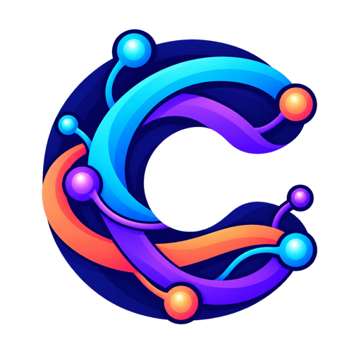
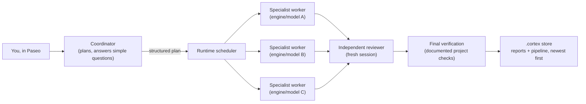

<p align="center">
  
</p>

<h1 align="center">Cortex</h1>
<p align="center"><strong>Multi-agent coordination for software work, as an ACP agent.</strong></p>

<p align="center">
  
  
  
  
  
  
</p>

<p align="center">
  <br />
  <strong>Recommended client: <a href="https://github.com/getpaseo/paseo">Paseo</a></strong>
</p>

Cortex is an incoming [ACP](https://agentclientprotocol.com) agent: a client
such as Paseo talks to it over stdio, and Cortex acts as a coordinator. It
plans your request, has its runtime dispatch independent specialist AI
workers — on different engines and models — to carry the plan out, sends
every change through a reviewer who did not write it, verifies the result
against your project's own checks, and keeps a durable, recoverable record
next to your project.

---

## Table of contents

- [What Cortex is](#what-cortex-is)
- [How orchestration works](#how-orchestration-works)
- [Why use orchestration](#why-use-orchestration)
- [Platform support](#platform-support)
- [Install in Paseo (recommended)](#install-in-paseo-recommended)
- [Other ACP clients](#other-acp-clients)
- [Configuration](#configuration)
- [Documentation](#documentation)
- [Development](#development)
- [Security](#security)
- [License](#license)

## What Cortex is

Cortex is an [ACP v1](https://agentclientprotocol.com) stdio agent
(`src/cortex_acp.py`) — it is not a plugin that runs inside another agent's
process. Any ACP-speaking client (Paseo, Zed, or others) launches Cortex as a
subprocess and talks to it over stdio. Internally, Cortex opens its own
outgoing ACP sessions against other coding agents —
[Codex](docs/features/codex-engine/index.md),
[Claude Code](docs/features/claude-engine/index.md), and the optional
[OpenCode v2](docs/features/opencode-engine/index.md) — and drives them
itself, inside the exact project your client has open.

The runtime, not any model, owns the task lifecycle: scheduling, dependency
resolution, write-conflict serialization, permissions, mandatory independent
review, verification, and completion. Models propose plans, carry out the
assigned work, and report evidence back — they cannot grant themselves
access, skip review, or declare a task finished on their own say. See the
[architecture overview](docs/project/architecture.md) for the full source
map.

## How orchestration works



1. **You talk to the coordinator.** It is read-only: it can answer a simple
   question straight from what it can already read, but any change,
   investigation, or capability outside its own role becomes a specialist
   assignment in a structured plan instead. See
   [capability-based delegation](docs/features/roles-and-delegation/index.md#capability-based-delegation).
2. **The runtime validates the plan and schedules workers.** Each plan node
   names a role (coder, reviewer, tester, designer, technical writer, and 19
   others) and may carry a model recommendation, but the runtime — not the
   model — makes the final engine/model/effort decision from the current
   catalog, task tier, work kind, and routing policy. See
   [automatic routing](docs/features/routing-and-fallback/index.md#automatic-worker-routing-tiers-model-hints-and-ranking).
3. **Independent specialist workers run in parallel**, one ACP session per
   worker, each on the engine/model the runtime picked for it. One chat
   session runs up to four workers at once across every engine and role.
   Workers whose declared write scopes overlap are serialized so they never
   race on the same files; read-only and non-overlapping work runs
   concurrently. See
   [plan submission and scheduling](docs/features/orchestration/index.md#plan-submission-and-coordinator-polling).
4. **A fresh, independent reviewer checks the diff** before anything counts
   as done, unless a plan genuinely changed no project file. The reviewer
   never wrote the code it is reviewing. See
   [review and verification](docs/features/index.md).
5. **Final verification runs the project's own documented commands** —
   tests, type checks, lints, whatever the plan declared — against the real
   checkout before the task can complete. A failing or unrun check blocks
   completion; it is never silently waived.
6. **Everything is recorded next to your project.** Immutable Markdown
   worker/reviewer reports and one newest-first pipeline document per task
   live under the project's own `.cortex/` folder, indexed by a local SQLite
   file, so nothing lives only in chat scrollback. These records themselves
   stay on your machine, but getting there still means running the engines
   you chose, and some of those engines send your prompts and project
   content to an external AI provider under that provider's own policy. See
   [storage and recovery](docs/project/storage.md) and
   [PRIVACY.md](PRIVACY.md) for exactly what stays local versus what a
   provider processes.

## Why use orchestration

- **Parallel specialists instead of one long linear thread.** Independent
  pieces of work run as separate workers at the same time, instead of one
  agent doing everything serially.
- **The right engine and model for each job.** Routing is computed by the
  runtime from real catalog data, task tier, and work kind — not guessed by
  whichever model happens to be talking to you.
- **Mandatory independent review.** A worker's own output is never
  self-certified; a separate reviewer session checks the diff first.
- **Verification before completion.** A task cannot be marked done until the
  project's own documented checks actually pass against the current code.
- **Durable, recoverable history.** Reports and the task pipeline are
  immutable Markdown files plus a local SQLite index inside your project's
  `.cortex/` folder, so you can inspect or recover task history without
  relying on client-side chat memory.
- **Permission and scope control.** Writers get a declared scope that
  serializes conflicting writes; read-only roles (including the coordinator)
  cannot write the project at all; Development/Guarded/Auto access modes
  control how much a worker's commands can touch outside the project. See
  [permissions and containment](docs/features/permissions-and-containment/index.md).

Documentation never references internal task/assignment/report identifiers —
these pages describe product behavior, not how a particular run was tracked.

## Platform support

Orchestration is developed and tested only on **Ubuntu (Linux)**. Other
platforms (macOS, Windows, WSL) are untested and not currently supported;
expect to find and fix gaps yourself if you try one.

## Install in Paseo (recommended)

[Paseo](https://github.com/getpaseo/paseo) is the primary, recommended ACP
client for Cortex: it has a native Cortex provider plugin, shows per-worker
cards with live status and token usage, and is what orchestration is
qualified against. The steps below are exact commands from this repository;
for the local-checkout path, replace `/absolute/path/to/cortex-orch-acp` with
where you cloned it. Busy-message acknowledgements close their display message
before worker waiting resumes, so later worker cards do not wait behind that
acknowledgement for the whole task to end.

### Prerequisites

- **Ubuntu (Linux)** — see [Platform support](#platform-support).
- **Python 3.11+** with only the standard library — `cortex_runtime` has no
  pip dependencies for the agent itself.
- **[Paseo](https://github.com/getpaseo/paseo)** installed and running.
- **At least one supported engine**, each with its own existing account or
  credential, set up independently of Cortex:
  - [Codex CLI](docs/features/codex-engine/index.md) (native ChatGPT login or
    `CODEX_API_KEY`/`OPENAI_API_KEY`), and/or
  - [Claude Code](docs/features/claude-engine/index.md) (native `claude
    /login` or an Anthropic API key).

  A native-account connection never has Cortex copy or store that login
  itself — it only runs the CLI you already authenticated. An API-key
  connection is different: the key you give Cortex is written to a private,
  owner-only secret file Cortex manages (see
  [Connect an engine](#2-connect-an-engine)); it is never logged or printed.
- **`git`** — only needed for the local-checkout install path below.

### 1. Install the plugin

The simplest path is a Git-hosted install straight from GitHub — no local
clone needed. With Paseo running:

```bash
paseo plugin install github:igovet/cortex-orch-acp:integrations/paseo
```

This installs from the repository's default branch (`main`). Use
`--ref <branch|tag|commit>` to track a different ref instead — for example
`--ref dev` for the active development branch.

If you already have (or want) a local checkout instead of a GitHub-hosted
install, clone the repository and run the local-checkout setup command
instead, which validates the repository-owned `integrations/paseo` plugin,
installs or reloads it in your Paseo daemon, and verifies it comes up
`running`:

```bash
git clone https://github.com/igovet/cortex-orch-acp.git
cd cortex-orch-acp
python3 -B scripts/cortex_acp_setup.py install-paseo-plugin
```

Both commands are idempotent and safe to rerun; neither touches unrelated
Paseo plugins or configuration. After either one, Paseo exposes Cortex as a
native provider named `cortex` for new chats — no separate generic ACP agent
registration is needed. See
[the Paseo provider plugin](docs/project/packaging.md#paseo-provider-plugin)
for the full Git-hosted install and update reference.

### 2. Connect an engine

Registering a connection needs an **install record**: a small JSON file that
names the exact files (Node binary, adapter entry point, package hashes)
Cortex is allowed to execute for that engine. Prepare it once per engine by
following [the Codex install record](docs/features/codex-engine/index.md#current-runtime-gateway-policy)
or [the Claude install record](docs/features/claude-engine/index.md#pinned-install-requirements-manual-recipe-placeholder) —
both link the exact template Cortex verifies against. The record never
contains a credential.

An API-key secret is always read from a file or stdin — never put it on the
command line:

```bash
# Native account login (Codex or Claude's own CLI login, run outside Cortex)
python3 -B scripts/cortex_acp_setup.py add-connection \
    --name work --engine codex-acp --provider openai \
    --auth-mode native_account \
    --install-record /path/to/codex-install-record.json

# Or an API key, read from a file (never inline on argv)
python3 -B scripts/cortex_acp_setup.py add-connection \
    --name work --engine claude-agent-acp --provider anthropic \
    --auth-mode api_key --key-kind anthropic_api_key \
    --api-key-file /path/to/key.txt \
    --install-record /path/to/claude-install-record.json
```

Both commands print a `connection_id` (`cn_xxxxxxxxxxxx`) — save it; the
steps below need it.

For `native_account`, `add-connection` does not import an existing login by
itself: it prints non-secret instructions naming an isolated directory and
environment variable (for example `CODEX_HOME=...`). Run that engine's own
native login with exactly that variable set, as instructed — this is where
the actual authentication happens, entirely outside Cortex — then confirm
the connection is ready:

```bash
python3 -B scripts/cortex_acp_setup.py validate-connection \
    --connection cn_xxxxxxxxxxxx
```

Re-run `validate-connection` until it reports a qualified, ready state before
pinning a route. `api_key` connections are generally ready immediately after
`add-connection`, but running `validate-connection` once is still a safe
sanity check.

Then pin a default route so a new chat picks a model automatically, with no
further per-task action:

```bash
python3 -B scripts/cortex_acp_setup.py pin-route \
    --connection cn_xxxxxxxxxxxx --model gpt-5-codex
```

See [first-run setup](docs/project/packaging.md#first-run-setup) for the
full command reference, including `record-observation` for a route built
from a real observed engine configuration.

### 3. Verify it works

```bash
python3 -B scripts/cortex_acp_setup.py status
```

This only reads and reports current connection/route state — it is always
safe to run. Then open Paseo, start a new chat, and select the `cortex`
provider; you should be talking to the Cortex coordinator.

### Update

For the Git-hosted install:

```bash
paseo plugin update cortex-acp --check
paseo plugin update cortex-acp --yes
```

Add `--ref dev` (or whichever ref you installed with) to both commands if you
tracked a non-default ref.

For a local checkout, reinstall and reload instead — local directory sources
are reloaded, not updated with `plugin update`:

```bash
python3 -B scripts/cortex_acp_setup.py install-paseo-plugin
```

An update restarts the plugin process, which closes every open Cortex chat's
connection; reopening a chat shows a notice with its saved state, and
in-flight work is reconciled, not lost. See
[Paseo update and existing MCP registries](docs/project/packaging.md#paseo-update-and-existing-mcp-registries).

### Uninstall

```bash
python3 -B scripts/cortex_uninstall.py                                   # dry run, deletes nothing
python3 -B scripts/cortex_uninstall.py --remove-user-scope --i-confirm-removal
python3 -B scripts/cortex_uninstall.py --project /path/to/project \
    --remove-project-store --i-confirm-removal
```

This removes only Cortex's own `$XDG_CONFIG_HOME/cortex`,
`$XDG_STATE_HOME/cortex`, and (with `--project`) that one project's `.cortex`
store. It never touches engine installs, real credentials outside those
Cortex-owned roots, your project files, or Git history. See
[uninstall](docs/project/packaging.md#uninstall).

## Other ACP clients

Paseo is the recommended client, but any ACP stdio client can register
Cortex as a secondary provider:

```text
python3 -B /absolute/path/to/cortex-orch-acp/src/cortex_acp.py
```

- **[Zed](docs/features/zed-agent/index.md)** — Custom Agent setup, including
  the exact `settings.json` snippet.
- **[codeg](docs/features/codeg-agent/index.md)** — Custom Agent recipe
  (partly unverified; see that page's status note).

## Configuration

See the [configuration guide](docs/configuration.md) for connections,
routing policy, MCP server setup, and per-model eligibility. Paseo's Cortex
Settings screen exposes some of this; Cortex's own JSON configuration files
and project SQLite row remain authoritative either way. Cortex also
discovers project skills under `.agents/skills` (Codex) and, through a
guarded symlink, `.claude/skills` (Claude Code) — see
[skill management](docs/features/skill-management/index.md).

## Documentation

- [Project overview](docs/project/index.md) — start here for project-wide pages
- [Feature index](docs/features/index.md) — one page per product feature
- [Packaging, onboarding and diagnostics](docs/project/packaging.md)
- [Orchestration](docs/features/orchestration/index.md) — scheduling, review, verification in depth
- [Roles and delegation](docs/features/roles-and-delegation/index.md) — the 23 specialist roles
- [Routing and fallback](docs/features/routing-and-fallback/index.md)
- [Permissions and execution containment](docs/features/permissions-and-containment/index.md)
- [Storage and recovery](docs/project/storage.md)
- [Verification](docs/project/verification.md)

## Development

Contributing to Cortex itself — running the test suite, the isolated dev
Paseo environment, and live qualification — is covered separately from this
end-user install guide:

- [Verification](docs/project/verification.md) — release-readiness checks
- [Automated test matrix](docs/project/test-matrix.md) — commands and CI
- [Isolated dev Paseo environment](docs/project/dev-environment.md) — a
  separate `~/.paseo-dev` daemon and disposable project for plugin
  development; it never touches a production Paseo install
- [Conventions](docs/project/conventions.md)

## Security

See [SECURITY.md](SECURITY.md) for the current ACP sandboxing and permission
boundary, and [PRIVACY.md](PRIVACY.md) for data handling. Report
vulnerabilities as described there rather than in a public issue.

## License

[MIT](LICENSE)
