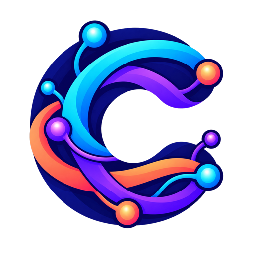
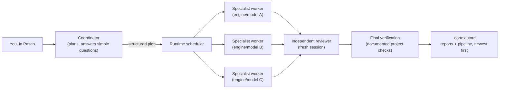

<p align="center">
  
</p>

<h1 align="center">Cortex</h1>
<p align="center"><strong>Multi-agent coordination for software work, as an ACP agent.</strong></p>

<p align="center">
  
  
  
  
  
  
</p>

<p align="center">
  <br />
  <strong>Recommended client: <a href="https://github.com/getpaseo/paseo">Paseo</a></strong>
</p>

Cortex is an incoming [ACP](https://agentclientprotocol.com) agent: a client
such as Paseo talks to it over stdio, and Cortex acts as a coordinator. It
plans your request, has its runtime dispatch independent specialist AI
workers — on different engines and models — to carry the plan out, sends
every change through a reviewer who did not write it, verifies the result
against your project's own checks, and keeps a durable, recoverable record
next to your project.

Paseo history restoration validates message identity and replay completeness;
the 0.14.0 SDK's derived message and reasoning IDs are supported by the replay gate. See
[history recovery](integrations/paseo/HISTORY.md) for verification limits.

For local desktop Debian builds, run `./scripts/build-dev-deb.sh` or
`./scripts/build-prod-deb.sh`; archives stay under git-ignored `.workspace-build/`.
Run the prod wrapper explicitly for a non-official production-channel build in a disposable environment; its Debian version ends in `.local` and is rejected by the GitHub publisher. Dev remains the default, with a separate store.
See [local build instructions](docs/project/packaging.md#local-desktop-debian-builds). An installed interaction pass does not qualify an archive that emits a native crash or allocator diagnostic; the installed gate must remain fail-closed. The Linux task window leaves GPU compositing available. Approved closure waits for outstanding service replies, then terminates only its WebKit web process through the public API before destroying the view, avoiding its EGL/Skia exit race without disabling compositing. Failed closure leaves a visible reason; the independent service stays alive. Disposable software-display checks are not real-GPU performance qualification.

Workspace supports editing a never-started task's saved request and adding drafts to an active sprint. Close sprint explicitly archives the sprint and stops its queue, preserving unfinished tasks and any running execution; Archive keeps the summary. See [editing and sprint closure](docs/cortex-workspace/local-task-execution.md#editing-saved-tasks-and-closing-sprints).

Workspace keeps working indicators static instead of scheduling permanent animation frames. Conversation history is reused by task/execution version, and slow Git completion publishes facts rather than starting another full refresh. See [CPU measurements and limits](docs/cortex-workspace/performance.md#recorded-on-the-reference-machine).

Workspace Git status, diff and log inspect raw content without requiring installed clean/smudge filters. Write commands retain normal filter and hook requirements; repository configuration is not changed.

Ready desktop results retain an explicit Accept control in Conversation and the diff review, separate from committing or merging. Same-branch tasks use Finish and Commit wording in review, the sidebar and inspector as well as their action controls; completed inspector outcomes appear once. Finished worker summaries unescape prose consistently, and worker notes use the full activity column rather than the icon column.

Workspace's local data API exposes retained coordinator messages and tool activity
with bounded continuation, plus confirmed model/effort labels for task and worker
projections. Worker views automatically read every available history page on open and retain activity across refreshes of the same attempt. Checkout labels say Project folder, with the branch shown separately; the project title shows the current open branch, not the Git default.
Review controls read committed runtime WAL data, so an active store does not falsely disable Accept.
Unknown routes remain absent rather than inheriting machine defaults.
A connected machine can still have an unconfirmed task. Its notice explains the difference and offers Re-check state and Diagnostics; sending stays off until confirmed facts arrive.
See [recorded activity and routes](docs/cortex-workspace/local-task-execution.md#recorded-data-and-pending-questions).

Workspace settings include release updates, native/API-key engine connections and
local Russian voice-model status. Add project also offers Clone from GitHub or
an absolute local bare Git repository path.
See the [desktop control map and verification limits](docs/cortex-workspace/maintenance-and-controls.md).
Alt+Left/Right navigate Workspace history in the native window. Published worker
reports stay open across background refreshes and display the whole report as formatted Markdown, including tables, lists and code. Worker and coordinator cards keep recorded model/effort visible in the full activity view; missing values are not invented. Saved profiles show their actual policy sections.
Removing and re-adding a project restores its retained history even when the projection has not changed.
New task worktrees use readable description-based names instead of transport ids;
existing checkouts keep their saved paths when the default root changes. Work waiting
for merge confirmation keeps its owner-action highlight. Result cards separate headings,
paragraphs, quotes and code, and omit empty outcome counters.
Plain project folders support tasks and result acceptance without Git. Git initialization is explicit;
local Commit, squash merge and task closure need no remote. Local-only repositories omit network controls and push/PR wording; generated commit messages are English independently of conversation language. Task actions open the actual checkout in the detected editor, with a visible reason when unavailable. Worktree settings allow writable external `.cortex/worktrees` folders, retain refused drafts with a persistent reason, and never move existing checkouts. Diagnostics list each failing check and its recovery steps, including in Copy report. Accept binds the reviewed runtime-evidence version while displaying its result number; late progress/transcript updates do not invalidate unchanged work. Refused or unconfirmed acceptance stays beside the result with a Refresh action, even after its toast closes;
withdrawn probes do not count as failed worker checks. Check programs are probed in the real verification environment before accepting a plan; workers can declare checks early through the same preflight. Probe launch failures remain unavailable observations, not false missing-program diagnoses. Missing tools require project-private installation or an executable alternative, with an immediate owner question when neither is possible. Review separates human-only items as **Check manually**, outside outcome counts and acceptance blockers. Rerun is available only for recorded commands, with fresh output and a bounded deadline; policy-prohibited checks stay explicitly not run. Legacy technical check blockers remain honest evidence and allow explicit acknowledged acceptance; an informational answer needs no invented tests. Sprint creation offers Project folder or Separate worktree, just like a single task. All tasks created from its plan inherit that choice; worktree mode prepares a separate worktree per task on explicit start. Sprint planning produces a description-only plan without starting implementation. Unusable model output and engine setup failures show a readable reason beside Retry planning, not just a cancelled badge; Create tasks saves drafts, and only an explicit task/queue start executes them. Planned tasks carry only their own item's scope and relevant plain-text owner answers, not sibling work or internal conversation records. Explicit unanswered owner questions belong to the relevant item. Review previews new text files as additions, preserves the implementation summary on no-file follow-ups, and retains unchanged missing-tool recovery. Local integration stages only non-helper user paths and restores prior staging if saving fails. See [local review and Git behavior](docs/cortex-workspace/local-task-execution.md).
Clickable controls use a pointer; disabled controls use the default cursor and text fields keep the text cursor.
Ready to merge distinguishes local content already in the target branch from its last-fetched push status. Already-contained work offers owner-confirmed closure, not another merge. Shared-checkout tasks on their target branch use recorded task-file evidence: committed content offers closure even after later sibling edits; known pending files offer Commit to that branch without sweeping other files into the commit. Unknown attribution offers Close as is or Done outside the app, never a same-branch merge. Board cards can be moved manually only to Done, with “Done outside the app” confirmation after the task stops. This durable owner decision is not acceptance, merging or passing checks; sprint dependencies can continue. See [local review and Git behavior](docs/cortex-workspace/local-task-execution.md).
Pointer and keyboard focus keep their behavior without adding decorative outlines or shifting controls.

Workspace saves a task from its description, then names it asynchronously through
its configured model route. Owner renames always win; unavailable naming
keeps the description fallback and marks title generation as failed. See [local task execution](docs/cortex-workspace/local-task-execution.md#automatic-task-titles).

Workspace reads as a conversation on every page, and every message box is one shared composer: Attach and Voice in the same places, model and effort where an engine is called, and a paper-plane button named for what it does (Send message, Send answer, Save draft, Create the task). Questions are answered inside the conversation, Home shows one Needs you list and the Inbox the same list for every machine, a board card shows one fact and one next action, controls side by side share one height and centre their labels, and the interface no longer names the program. Pages reflow down to phone width without scrolling sideways. See [Conversation adoption](docs/cortex-workspace/SCREENS.md#conversation-adoption).

Every Workspace form for a message or new work (task and sprint creation, conversations, direct-worker messages, answers inside a question, planning messages, Request changes, diff comments and conflict-resolution guidance) accepts dropped files,
clipboard images and picked files (eight files, 4 MiB combined), shown as removable chips with image thumbnails. Queue Edit
restores both text and file contents. Saved files can be opened from their task, sprint or message and saved through the system's save dialog; local JSON frames are bounded to 8 MiB. See [attachments](docs/cortex-workspace/local-task-execution.md#attachments).

Workspace supports on-device Russian dictation (Ctrl+D or microphone), with live
preview, Cancel, Insert and an explicit Insert and send action. A verified model
download runs once on first use; audio stays local. See [voice input](docs/cortex-workspace/local-task-execution.md#local-voice-input).

Workspace includes a local project terminal (Ctrl+J): your own shell, owned by the
machine service, with retained output across window closure. It starts in the registered
project, not a task worktree; the worktree-local terminal action is disabled with that reason. Close shell stops its
jobs; it is full owner shell access, not a sandbox. The native desktop notifies when a new question arrives outside the open task or sprint, subject to the desktop notification service and the Appearance setting. Notifications name the work, not question bodies; failed delivery stays explicit in the app.
See [terminal limits](docs/cortex-workspace/security.md#owner-terminal-built-local-linux).

Workspace resumes automatic sprints after answered questions, but keeps owner and
failed-check pauses. Skipped executable worker checks run automatically; check
reruns, including the native desktop button, use retained commands and real verification receipts, not model promises.
See [service-owned work](docs/cortex-workspace/local-task-execution.md#archive-and-service-owned-work).

---

Routing marks stored references to disabled models as inactive without deleting them; its enabled-model picker excludes denied models. Routing settings use each exact model's observed effort levels, including ordered effort ladders. Unknown levels are marked; saved unsupported values remain visible and unchanged. See [configuration](docs/configuration.md#manage-settings-in-paseo).

## Table of contents

- [What Cortex is](#what-cortex-is)
- [How orchestration works](#how-orchestration-works)
- [Why use orchestration](#why-use-orchestration)
- [Platform support](#platform-support)
- [Install in Paseo (recommended)](#install-in-paseo-recommended)
- [Other ACP clients](#other-acp-clients)
- [Configuration](#configuration)
- [Documentation](#documentation)
- [Development](#development)
- [Security](#security)
- [License](#license)

## What Cortex is

Cortex is an [ACP v1](https://agentclientprotocol.com) stdio agent
(`src/cortex_acp.py`) — it is not a plugin that runs inside another agent's
process. Any ACP-speaking client (Paseo, Zed, or others) launches Cortex as a
subprocess and talks to it over stdio. Internally, Cortex opens its own
outgoing ACP sessions against other coding agents —
[Codex](docs/features/codex-engine/index.md),
[Claude Code](docs/features/claude-engine/index.md), and the optional
[OpenCode v2](docs/features/opencode-engine/index.md) — and drives them
itself, inside the exact project your client has open.

Exact adapter support includes Codex ACP **2.3.0** and Claude ACP **0.97.0**,
with **2.1.1** and **0.88.0** retained for rollback. Both newer adapters retain
Cortex's ACP v1 path; source qualification and no-paid initialization do not
establish paid CLI or desktop behavior. See the engine pages above.

The runtime, not any model, owns the task lifecycle: scheduling, dependency
resolution, write-conflict serialization, permissions, mandatory independent
review, verification, and completion. Models propose plans, carry out the
assigned work, and report evidence back — they cannot grant themselves
access, skip review, or declare a task finished on their own say. See the
[architecture overview](docs/project/architecture.md) for the full source
map.

## How orchestration works



1. **You talk to the coordinator.** It is read-only: it can answer a simple
   question straight from what it can already read, but any change,
   investigation, or capability outside its own role becomes a specialist
   assignment in a structured plan instead. See
   [capability-based delegation](docs/features/roles-and-delegation/index.md#capability-based-delegation).
2. **The runtime validates the plan and schedules workers.** Each plan node
   names a role (coder, reviewer, tester, designer, technical writer, and 19
   others) and may carry a model recommendation, but the runtime — not the
   model — makes the final engine/model/effort decision from the current
   catalog, task tier, work kind, and routing policy. See
   [automatic routing](docs/features/routing-and-fallback/index.md#automatic-worker-routing-tiers-model-hints-and-ranking).
3. **Independent specialist workers run in parallel**, one ACP session per
   worker, each on the engine/model the runtime picked for it. One chat
   session runs up to four workers at once across every engine and role.
   Workers whose declared write scopes overlap are serialized so they never
   race on the same files; read-only and non-overlapping work runs
   concurrently. See
   [plan submission and scheduling](docs/features/orchestration/index.md#plan-submission-and-coordinator-polling).
4. **A fresh, independent reviewer checks the diff** before anything counts
   as done, unless a plan genuinely changed no project file. The reviewer
   never wrote the code it is reviewing. See
   [review and verification](docs/features/index.md).
5. **Final verification runs the project's own documented commands** —
   tests, type checks, lints, whatever the plan declared — against the real
   checkout before the task can complete. A failing or unrun check blocks
   completion; it is never silently waived.
6. **Everything is recorded next to your project.** Immutable Markdown
   worker/reviewer reports and one newest-first pipeline document per task
   live under the project's own `.cortex/` folder, indexed by a local SQLite
   file, so nothing lives only in chat scrollback. These records themselves
   stay on your machine, but getting there still means running the engines
   you chose, and some of those engines send your prompts and project
   content to an external AI provider under that provider's own policy. See
   [storage and recovery](docs/project/storage.md) and
   [PRIVACY.md](PRIVACY.md) for exactly what stays local versus what a
   provider processes.

## Why use orchestration

- **Parallel specialists instead of one long linear thread.** Independent
  pieces of work run as separate workers at the same time, instead of one
  agent doing everything serially.
- **The right engine and model for each job.** Routing is computed by the
  runtime from real catalog data, task tier, and work kind — not guessed by
  whichever model happens to be talking to you.
- **Mandatory independent review.** A worker's own output is never
  self-certified; a separate reviewer session checks the diff first.
- **Verification before completion.** A task cannot be marked done until the
  project's own documented checks actually pass against the current code.
- **Durable, recoverable history.** Reports and the task pipeline are
  immutable Markdown files plus a local SQLite index inside your project's
  `.cortex/` folder, so you can inspect or recover task history without
  relying on client-side chat memory.
- **Permission and scope control.** Writers get a declared scope that
  serializes conflicting writes; read-only roles (including the coordinator)
  cannot write the project at all; Development/Guarded/Auto access modes
  control how much a worker's commands can touch outside the project. See
  [permissions and containment](docs/features/permissions-and-containment/index.md).

Documentation never references internal task/assignment/report identifiers —
these pages describe product behavior, not how a particular run was tracked.

## Platform support

Orchestration is developed and tested only on **Ubuntu (Linux)**. Other
platforms (macOS, Windows, WSL) are untested and not currently supported;
expect to find and fix gaps yourself if you try one.

## Install in Paseo (recommended)

[Paseo](https://github.com/getpaseo/paseo) is the primary, recommended ACP
client for Cortex: it has a native Cortex provider plugin, shows per-worker
cards with live status and reported token/context snapshots, and is what
orchestration is qualified against. Missing context is explicit (OpenCode reports
it only at turn end); provider plan percentages are route-selection snapshots,
not live meters. Claude plan usage uses remaining reported windows such as weekly limits;
legacy session / 5-hour usage is ignored. Codex's own windows are unchanged.
Unsupported OpenCode plan usage stays unknown with a hint to
check the provider's account usage page. The steps below are exact commands from this repository;
for the local-checkout path, replace `/absolute/path/to/cortex-orch-acp` with
where you cloned it. Busy-message acknowledgements close their display message
before worker waiting resumes, so later worker cards do not wait behind that
acknowledgement for the whole task to end.

### Prerequisites

- **Ubuntu (Linux)** — see [Platform support](#platform-support).
- **Python 3.11+** with only the standard library — `cortex_runtime` has no
  pip dependencies for the agent itself.
- **[Paseo](https://github.com/getpaseo/paseo)** installed and running.
- **At least one supported engine**, each with its own existing account or
  credential, set up independently of Cortex:
  - [Codex CLI](docs/features/codex-engine/index.md) (native ChatGPT login or
    `CODEX_API_KEY`/`OPENAI_API_KEY`), and/or
  - [Claude Code](docs/features/claude-engine/index.md) (native `claude
    /login` or an Anthropic API key).

  A native-account connection never has Cortex copy or store that login
  itself — it only runs the CLI you already authenticated. An API-key
  connection is different: the key you give Cortex is written to a private,
  owner-only secret file Cortex manages (see
  [Connect an engine](#2-connect-an-engine)); it is never logged or printed.
- **`git`** — only needed for the local-checkout install path below.

### 1. Install the plugin

The simplest path is a Git-hosted install straight from GitHub — no local
clone needed. With Paseo running:

```bash
paseo plugin install github:igovet/cortex-orch-acp:integrations/paseo
```

This installs from the repository's default branch (`main`). Use
`--ref <branch|tag|commit>` to track a different ref instead — for example
`--ref dev` for the active development branch.

If you already have (or want) a local checkout instead of a GitHub-hosted
install, clone the repository and run the local-checkout setup command
instead, which validates the repository-owned `integrations/paseo` plugin,
installs or reloads it in your Paseo daemon, and verifies it comes up
`running`:

```bash
git clone https://github.com/igovet/cortex-orch-acp.git
cd cortex-orch-acp
python3 -B scripts/cortex_acp_setup.py install-paseo-plugin
```

Both commands are idempotent and safe to rerun; neither touches unrelated
Paseo plugins or configuration. Each seeds the [default preset](docs/configuration.md#default-preset)
into absent `routing.json`, `defaults.json` and `mcp-servers.json` files; the Git-hosted
install does this in its bootstrap step. A fresh install also creates one profile named
`default` in `routing-profiles.json`, selected and shown as **Applied** in Cortex Settings.
The MCP entries (`codebase-memory-mcp`, `playwright`, `vivaldi`) start **disabled**, with
`/path/to/...` examples instead of personal paths. Install their executables and edit
those examples before enabling them; Cortex does not download or launch these MCP servers.
Every later Cortex agent start repeats the
same absent-only seeding and never overwrites an existing file. After either one, Paseo exposes Cortex as a
native provider named `cortex` for new chats — no separate generic ACP agent
registration is needed. See
[the Paseo provider plugin](docs/project/packaging.md#paseo-provider-plugin)
for the full Git-hosted install and update reference.

### 2. Connect an engine

**Automatic native-account setup (`codex-acp` and `claude-agent-acp`).** On
plugin or agent startup, Cortex seeds missing default-preset files and downloads
its own qualified adapters from the Workspace package bundle when present. Checkout-only installs can download pinned adapters in the background through npm into
`$XDG_DATA_HOME/cortex/engines`, or `~/.local/share/cortex/engines`. When an
engine's native login marker exists, Cortex registers its missing connection
and immediately loads its model list, without sending a model prompt. Existing
connections are preserved. Cortex Settings → Connections shows progress and failures.
Its background checks retain connection rows and unsaved edits; failed checks
mark the last known status and offer a retry rather than hiding the form.

Log in once outside Cortex with the engine's own command (`codex login` or
`claude` and `/login`). If automatic setup already finished without a login,
restart the plugin/agent or use *Add connection* with its opt-in switch. Removing
a connection disables automatic registration for that engine; only an explicit
*Add connection* restores it. *Download engine* remains a manual retry (up to a
minute). `CORTEX_ENGINE_UPDATE=off` skips the automatic setup pass. No credential
is copied, and OpenCode remains manual.

Settings checks only that the engine's login marker file exists, not that the login
works, so press *Validate* on the new connection. Settings never asks for an API key.
OpenCode appears in the same list for its status only; enable it with *Enable OpenCode v2*
in its own section, and Cortex never downloads it. See [Manage settings in Paseo](docs/configuration.md#manage-settings-in-paseo).

**From the command line** (native account or API key). Registering from the command line
needs an **install record**: a small JSON file that
names the exact files (Node binary, adapter entry point, package hashes)
Cortex is allowed to execute for that engine. Prepare it once per engine by
following [the Codex install record](docs/features/codex-engine/index.md#current-runtime-gateway-policy)
or [the Claude install record](docs/features/claude-engine/index.md#pinned-install-requirements-manual-recipe-placeholder) —
both link the exact template Cortex verifies against. The record never
contains a credential.

An API-key secret is always read from a file or stdin — never put it on the
command line:

```bash
# Native account login (Codex or Claude's own CLI login, run outside Cortex)
python3 -B scripts/cortex_acp_setup.py add-connection \
    --name work --engine codex-acp --provider openai \
    --auth-mode native_account \
    --install-record /path/to/codex-install-record.json

# Or an API key, read from a file (never inline on argv)
python3 -B scripts/cortex_acp_setup.py add-connection \
    --name work --engine claude-agent-acp --provider anthropic \
    --auth-mode api_key --key-kind anthropic_api_key \
    --api-key-file /path/to/key.txt \
    --install-record /path/to/claude-install-record.json
```

Both commands print a `connection_id` (`cn_xxxxxxxxxxxx`) — save it; the
steps below need it.

For `native_account`, `add-connection` does not import an existing login by
itself: it prints non-secret instructions naming an isolated directory and
environment variable (for example `CODEX_HOME=...`). Run that engine's own
native login with exactly that variable set, as instructed — this is where
the actual authentication happens, entirely outside Cortex — then confirm
the connection is ready:

```bash
python3 -B scripts/cortex_acp_setup.py validate-connection \
    --connection cn_xxxxxxxxxxxx
```

Re-run `validate-connection` until it reports a qualified, ready state before
pinning a route. `api_key` connections are generally ready immediately after
`add-connection`, but running `validate-connection` once is still a safe
sanity check.

Then pin a default route so a new chat picks a model automatically, with no
further per-task action:

```bash
python3 -B scripts/cortex_acp_setup.py pin-route \
    --connection cn_xxxxxxxxxxxx --model gpt-5-codex
```

See [first-run setup](docs/project/packaging.md#first-run-setup) for the
full command reference, including `record-observation` for a route built
from a real observed engine configuration.

### 3. Verify it works

```bash
python3 -B scripts/cortex_acp_setup.py status
```

This only reads and reports current connection/route state — it is always
safe to run. Then open Paseo, start a new chat, and select the `cortex`
provider; you should be talking to the Cortex coordinator.

### Update

For the Git-hosted install:

```bash
paseo plugin update cortex-acp --check
paseo plugin update cortex-acp --yes
```

Add `--ref dev` (or whichever ref you installed with) to both commands if you
tracked a non-default ref.

For a local checkout, reinstall and reload instead — local directory sources
are reloaded, not updated with `plugin update`:

```bash
python3 -B scripts/cortex_acp_setup.py install-paseo-plugin
```

An update restarts the plugin process, which closes every open Cortex chat's
connection; reopening a chat shows a notice with its saved state, and
in-flight work is reconciled, not lost. See
[Paseo update and existing MCP registries](docs/project/packaging.md#paseo-update-and-existing-mcp-registries).

### Uninstall

```bash
python3 -B scripts/cortex_uninstall.py                                   # dry run, deletes nothing
python3 -B scripts/cortex_uninstall.py --remove-user-scope --i-confirm-removal
python3 -B scripts/cortex_uninstall.py --project /path/to/project \
    --remove-project-store --i-confirm-removal
```

This removes only Cortex's own `$XDG_CONFIG_HOME/cortex`,
`$XDG_STATE_HOME/cortex`, and (with `--project`) that one project's `.cortex`
store. It never touches engine installs, real credentials outside those
Cortex-owned roots, your project files, or Git history. See
[uninstall](docs/project/packaging.md#uninstall).

## Cortex Workspace desktop (in development)

Starting a task is independent of other tasks in the same project, including retained waiting or recovering ACP tasks. Pending, unknown or running Workspace starts also do not block new ordinary ACP tasks. A duplicate start is refused only for that already-started task; a crashed start remains unknown without replay. Sprint queues still select tasks by dependency order and pause for attention. Manual Start does not enforce that order on the server. See [local task execution](docs/cortex-workspace/local-task-execution.md#choices-and-checkout).

Cortex Workspace is a desktop application being built alongside Cortex. Its local slice is built and checked, but it is not released. A user-level service owns the Cortex agent process and talks to Cortex through the `_cortex/workspace` extension method, in addition to the standard ACP methods. The service listens only on a private Unix socket and opens no network port. The Ubuntu package is built in a Docker container with `python3 -B scripts/build_workspace_desktop.py`; a local build is the dev channel. Releases start manually through GitHub Actions: choose `main` for production (`v<debian-version>`, Latest), or `dev` for a separate dev prerelease (`dev-v<debian-version>`, never Latest). Both appear in one release list. Dev and production can coexist, including in the same project folder: Dev uses `.cortex-dev` beside release `.cortex` without reading or migrating release data. There is one store per logical project per channel, shared by its linked worktrees. Project metadata stays inside the channel store; Dev reserves `.cortex-dev/owner.json`, not a root JSON file. Saved sprint plans can restore missing member drafts after an upgrade, without reading release history; the queue pauses for review before any new start. Dev installs manually and has no in-app updates. See the [release steps](docs/project/packaging.md#manual-workspace-releases). See [Cortex Workspace](docs/cortex-workspace/index.md) for the design, the contract and the current status, and [SECURITY.md](SECURITY.md) for its trust boundary.

Both dev and release `.deb` packages include the complete Cortex runtime. Debian versions now put an increasing UTC build stamp before the content hash, with a `z` prefix that sorts above all older hash-only versions. The embedded runtime identity is unchanged; see [build ordering and reproducibility](docs/cortex-workspace/platforms.md#debian-build-ordering-and-reproducibility). Install with `sudo apt install ./cortex-workspace-dev_*.deb` (or the release package), then launch the application: no checkout, settings clone or `service.env` is required. The package arranges service startup at login; the desktop starts its own unit in an existing session. Upgrade restarts active user units best effort, and removal leaves user data intact. Both channels include qualified Codex/Claude adapters, their locked dependencies and checksum-verified Node 24.14.1 under `/usr/lib/<package>/engines`; first activation needs neither npm nor an adapter download. Native logins stay in `~/.codex` and `~/.claude`, never copied. Models still require account access and network; missing login or failed discovery is shown separately from service connectivity. Installer, systemd and sandbox qualification limits are in [platforms](docs/cortex-workspace/platforms.md).

The real task conversation reads durable Cortex messages, plans, tool activity, questions and results. Owner messages and the unsent queue survive reopening. Workers show retained activity and accept owner guidance at their next successful Cortex tool call; this is not an immediate interrupt. Task Stop records a resumable pause, distinct from cancelling an engine turn or an individual worker. Task-level and pending worker questions remain visible but cannot be answered until Resume, including after service restart. Worker waits continue through a recorded replacement attempt, not a claim of reviving the old engine; access is revalidated on the new channel. Stopping one worker still cancels its own wait. An opened worker report is shown whole, retrieved internally in bounded public pages; one byte-budgeted continuation loads older task activity, command-control and guidance together, including attachment and delivery details. Check-rerun and review-comment controls return requests to Cortex, not synthetic passing evidence. See the [local conversation contract](docs/cortex-workspace/protocol.md).

The task execution slice adds per-task route/access/language choices, linked task worktrees sharing one project store, task-owned diffs, guarded squash/PR actions, real runtime-row purge with space reclamation, project overrides and window-independent automatic queues. Automatic LLM titles remain unavailable. Pre-save MCP listing now uses the existing sandbox with a bounded deadline, and Open logs opens private rotating status events (never raw stderr). Sprint-created tasks inherit their route and target; partial composer-setting failures name what was acknowledged. These additions still require fresh installed-package and native-rendered qualification. See [local task execution](docs/cortex-workspace/local-task-execution.md) for safety refusals, evidence limits and focused checks.

Task and project ages use recorded timestamps, not refresh time, and elapsed times use whole seconds/minutes/hours. All work shows unmaterialized sprint planning explicitly. Pending worker questions reach the task, Inbox and sidebar even while other workers continue. Weekly Claude/Codex limits use the runtime quota reader, with bundled Claude CLI fallback when no global CLI is on PATH; no five-hour or OpenCode usage is displayed. Codex weekly display follows the reported 10080-minute duration, whether the provider calls that slot primary or secondary. Missing duration or expired quota remains unavailable.

First activation and background setup are followed by fresh configuration reads. Settings conflicts keep the draft for explicit review and reapplication, while Git Commit uses the visible local message immediately. Sprint planning requires a connected, selectable model before creating planning work. Worktree reset uses the service-reported channel default and never moves existing checkouts. See [local task execution](docs/cortex-workspace/local-task-execution.md).

Workspace invalidations use connection-local SQLite hooks on supported Store writers; they do not install a callback dependency on independent or older SQLite writers. See [storage](docs/project/storage.md#workspace-adapter-tables) for upgrade and inspection behavior.

## Other ACP clients

Paseo is the recommended client, but any ACP stdio client can register
Cortex as a secondary provider:

```text
python3 -B /absolute/path/to/cortex-orch-acp/src/cortex_acp.py
```

- **[Zed](docs/features/zed-agent/index.md)** — Custom Agent setup, including
  the exact `settings.json` snippet.
- **[codeg](docs/features/codeg-agent/index.md)** — Custom Agent recipe
  (partly unverified; see that page's status note).

## Configuration

Existing Codex/Claude connections follow newer source-approved adapters already
installed in Cortex's owned engine root at startup and after approved updates.
Accounts, routes and model settings are preserved; unregistered versions never
replace approved ones, and automatic downgrades are forbidden.
See [adapter following and rollback](docs/configuration.md#approved-adapter-following-and-rollback)
for private backups and `CORTEX_ENGINE_FOLLOW=off`.

The [fresh-install preset](docs/configuration.md#fresh-install-owner-default-snapshot)
includes `codex-acp/gpt-6.1-terra` for standard-tier automatic routing at medium-to-high
effort, now ranked first for standard-tier writing, testing and debugging by
removing competing purpose preferences (not by list order or a pin). Other models
remain eligible when Terra is unavailable or exhausted; purpose preference yields
at known usage >=95% when more than 10 points worse than an available alternative.
Provider choices and hard eligibility still apply. Normal-complexity technical
writers remain light-tier. The 2026-10-27 sync also
sets the portable coordinator to `claude-agent-acp/opus[1m]` at medium effort.
Existing owner settings are unchanged; the preset is not live model qualification.
The **Default preset** card in Settings' User defaults section shows all four preset files. It
can seed missing files without replacing existing settings or saved profiles, or reset
only routing/defaults after confirmation; reset
keeps a private backup of each existing file. See [Default preset](docs/configuration.md#default-preset).

See the [configuration guide](docs/configuration.md) for connections,
routing policy, MCP server setup, and per-model eligibility. Paseo's Cortex
Settings screen exposes some of this; Cortex's own JSON configuration files
and project SQLite row remain authoritative either way. Cortex also
discovers project skills under `.agents/skills` (Codex) and, through a
guarded symlink, `.claude/skills` (Claude Code) — see
[skill management](docs/features/skill-management/index.md).

## Documentation

- [Project overview](docs/project/index.md) — start here for project-wide pages
- [Feature index](docs/features/index.md) — one page per product feature
- [Packaging, onboarding and diagnostics](docs/project/packaging.md)
- [Orchestration](docs/features/orchestration/index.md) — scheduling, review, verification in depth
- [Roles and delegation](docs/features/roles-and-delegation/index.md) — the 23 specialist roles
- [Routing and fallback](docs/features/routing-and-fallback/index.md)
- [Permissions and execution containment](docs/features/permissions-and-containment/index.md)
- [Storage and recovery](docs/project/storage.md)
- [Verification](docs/project/verification.md)

## Development

Contributing to Cortex itself — running the test suite, the isolated dev
Paseo environment, and live qualification — is covered separately from this
end-user install guide:

- [Verification](docs/project/verification.md) — release-readiness checks
- [Automated test matrix](docs/project/test-matrix.md) — commands and CI
- [Isolated dev Paseo environment](docs/project/dev-environment.md) — a
  separate `~/.paseo-dev` daemon and disposable project for plugin
  development; it never touches a production Paseo install
- [Conventions](docs/project/conventions.md)

## Security

See [SECURITY.md](SECURITY.md) for the current ACP sandboxing and permission
boundary, and [PRIVACY.md](PRIVACY.md) for data handling. Report
vulnerabilities as described there rather than in a public issue.

## License

[MIT](LICENSE)
