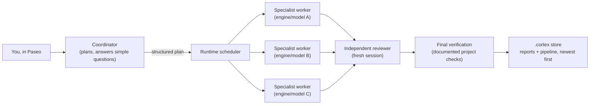

<p align="center">
  
</p>

<h1 align="center">Cortex</h1>
<p align="center"><strong>Multi-agent coordination for software work, as an ACP agent.</strong></p>

<p align="center">
  
  
  
  
  
  
</p>

<p align="center">
  <br />
  <strong>Recommended client: <a href="https://github.com/getpaseo/paseo">Paseo</a></strong>
</p>

Conversation waits explain when decision details are unavailable and point to Answer in the header. Open decisions also render before their timeline reference arrives. Sent attachment chips tolerate the whitespace normalization used by runtime history.

In Workspace, Changes excludes target-only changes after **Update from target**, including when **Finish merge** confirms an update you committed in Git. See [IDE and Git](docs/cortex-workspace/ide-and-git.md).

In Workspace, you can add a comment to a route choice without changing the selected route. Explicit refusals still apply. See [routing and consent](docs/project/native-incoming-acp.md#native-routing-and-retained-consent).

Workspace result checks list recorded skips with their reasons, including checks that required authorization and did not run.

Workspace engine limits retain connected engines with an explicit Unavailable state when no provider usage is observed. Coordinator choices exclude switched-off engines. See [desktop engine controls](docs/cortex-workspace/maintenance-and-controls.md).

The incoming Rust ACP-v1 binary in `crates/cortex-acp` is the only entry for
Zed registration, the Paseo setup launch record and a Paseo source-root launch:
this checkout's `target/debug/cortex-acp`, built with
`cargo build --locked --offline -p cortex-acp -p cortex-paseo-tools`. An unbuilt
default refuses with that remedy. The Python entry and runtime were removed on
2026-11-16 (the product contains no Python); an earlier owner-requested live Paseo `cli`
qualification on Claude and Codex native accounts covered the Rust entry before
that removal, and live Zed qualification was not run. `--rust-binary` and
`CORTEX_ACP_RUST_BINARY` name another binary. The Git-install bootstrap builds and
stages the Rust binaries. Known limits remain; see
[native launch and limits](docs/project/native-incoming-acp.md#default-launch).
The Paseo shim accepts the public absolute runtime root. Native question cards and
engine permission requests keep their response correlation until an answer or
cancellation, rather than expiring after 30 seconds; disconnect clears pending waits.
Sessions accept client MCP entries no engine is handed, such as the HTTP
server Paseo injects into every session; an unconfigured stdio server still refuses.
Cortex tool discovery lists only Cortex tools. For external MCP, use the exact
tool name and description advertised by the engine for the current session;
if a code index is not offered, use the available project reads instead.
For file changes that require read coverage, use direct reads or inline batch
pages; [deferred batch reads](docs/features/tool-discovery-and-read-batch/index.md#bounds-and-delivery)
do not count toward coverage.
Question cards use Python's Paseo card shape, and the cancel Paseo sends before a
follow-up message is held for five seconds as in Python, so the message steers and
`/cortex-answer` still answers instead of pausing the task.
The exact-hash Codex 2.3.0 and 2.6.0 installs' model catalogue is observed natively.
The binary must be built separately. Startup checks, model-efforts output, preset
and default-profile seeding, approved-adapter following and Python's request
error envelopes are available. The background engine download/registration/
catalogue pass also runs and uses verified packaged bundles; a launch the native verifier still does not admit is not observed and reports `native_catalog_unavailable`, so first-run parity is incomplete (a Codex adapter package whose `@openai/codex` dependency or vendored binary Python cannot resolve is now launched directly and observed like Python's unverified launch).
For a Rust launch the plugin's read-only store readers (worker history and results,
running commands, pipeline, project root and task binding) and its Settings reads
(user defaults, routing, profiles, MCP servers, connections and the model catalogue)
run in the Rust `cortex-paseo-tools` binary, which must sit beside `cortex-acp`
(`cargo build --locked --offline -p cortex-acp -p cortex-paseo-tools`); without it
those reads are refused, never served by Python. Its output is byte-identical to the
Python readers on fixture stores and homes, apart from two declared value-free native
messages (`cargo test --locked --offline -p cortex-paseo-tools`).
Every Settings change also runs natively there: user defaults, routing (user and
project files), routing profiles (create, save, update, delete, activate,
deactivate), MCP servers, connection rename/session limit/validate/remove, the
project ceiling and the default preset (read, apply, reset), plus catalogue refresh,
engine discovery, onboarding and pinned engine download. Each keeps the Python API's
revision checks, owner lock, atomic file bytes/modes and refusal payloads (`field`,
per-item `errors`, `current_revision`), checked against Python on fixture homes.
Plugin automatic setup runs `cortex-paseo-tools setup`, cortex-acp's native first-run
pass. Build both binaries for the same channel: Settings, setup and the agent share
compiled-channel roots. Dev uses `cortex-workspace-dev` beneath the launch XDG config
root and `cortex-workspace-dev/state` beneath its XDG state root, plus `.cortex-dev`
for project settings; release keeps the ordinary roots and `.cortex`. A runtime
`CORTEX_WORKSPACE_CHANNEL` value cannot switch these native Settings roots. Only shapes the Python provider alone can answer refuse explicitly with
`config_api_unavailable` and their reason before any effect: an OS-keyring connection
validation, an installed or named OpenCode binary (its version probe needs the
OpenCode namespace jail), a catalogue refresh whose engine has no qualified native
producer, and settings numbers outside the exact native range. See
[Settings under the Rust launch](docs/project/native-incoming-acp.md#paseo-settings-under-the-rust-launch).
Cached first-run catalogue entries must pass evidence and route-identity validation;
new observations publish under the registry lock after rechecking the connection.
Startup reads and rewrites `connections.json` exactly as Python does, including
Python-only JSON values in its override history; it repairs an existing open
configuration root to 0700 and waits for the owner lock without a bound, like
Python. A pre-task model or effort choice is saved as the user-default route; a
model change drops the previous model's effort before the new model is checked,
while re-sending the current model keeps it, like Python. The provider, model and
thought-level options now match Python's picker: Zed gets per-account providers
(labelled with the signed-in account when it can be read) and provider-scoped
models, Paseo gets one model picker with exact route IDs across accounts, and
the thought level shows its observed default. Each new session also refreshes
the catalogue once per connection without a prompt, like Python. Every Python
`/cortex-*`, `/harvest`, `/harvest-refresh` and `/skill-management` command is
advertised and replies with Python's text, usage errors and transcript;
`/cortex-clear` previews retention but refuses a confirmed deletion, and other
`/cortex-*` text that Python does not recognize is an ordinary prompt.
`/cortex-new-task` retains the invoking client's access mode and language; cancelling
that prompt stops only its separate task, not the invoking session's existing task.
A missing route, image-capture refusals and refused-prompt transcript rows now match Python's
error envelopes. Image, embedded-resource and link attachments of a follow-up prompt
to an admitted native task are retained as its next source revision, listed under
that prompt's transcript row and sent with later engine prompts; one task's retained
attachments stay within 10 MiB in total. Internal control retries with the same request
identity and capture return the settled receipt without duplicating input; changed
captures conflict and unfinished controls remain unknown. While a turn runs, a typed message answers
its one open worker question (a number selects that option), `/cortex-answer <n>`
picks among several, and with Paseo's question cards a typed message also answers
the coordinator's open card, as in Python. Python-created
sessions reload with Python's options, read-only. Claude account-label lookup
shares one five-second deadline across execution, pipe reading and cleanup;
timeouts fall back to the engine name, including when a descendant retains stdout.
It uses the same native service host and refuses an already-owned project rather
than starting a competing scheduler. It is not the installed ACP entry point:
initial image/resource snapshots, worker question batches and read-only legacy
history loading and owner-configured stdio MCP worker attachment are supported.
External tool grants are filtered per role; consultants receive none. External
servers run in a Landlock/seccomp sandbox unless the owner explicitly sets
`"containment": "none"` per server or as the registry default, which runs them
with the owner's full user authority (see [configuration](docs/configuration.md)
and [SECURITY.md](SECURITY.md)). Native
routing now exposes owner-configured menus, plan hints, effort policy and
recorded-consent selection. Rust table tests cover the legacy English/Russian
request, chosen-option, project-instruction and explicit-effort cases; plan
previews retain instruction provenance and explain preferred or hot hints.
Coordinator questions now retain evidence-backed skill proposals and route exact
approval to the skill-management planning request; declined or unclear answers
never change project files. Channel-scoped native draft/publication/report reads and
bounded schema discovery are available; published results must name the calling
principal's own evidence. Native model, effort and language slash commands reuse
the validated selectors. Access controls now persist Development/Guarded/Auto,
confirm observed worker engine modes and govern one-shot outside-write/command
routes. Workspace-service recovery now adopts Python-owned format-12 tasks under
its scheduler fence, advances their owner epoch and preserves unknown-effect
barriers. Settled checkpoints and pending questions continue natively; old sessions
and in-flight effects are never replayed. Native history reload does not dispatch
tasks; explicit follow-up input
resumes a paused task, and new-session startup can recover a settled coordinator
from retained state. Observed compaction and settled coordinator replacement
rebuild bounded capsules from recorded constraints, answers, sources and current
work; instructions and served schemas are redelivered. Post-verification
reconciliation supports synthesis, owner questions, certified answers,
verification repair and budgeted replan/scope/escalation proposals. Rejected
synthesis disclosures now identify the current unresolved check names and explain
how to correct the proposal; old revision names cannot silently close new gaps.
Permission approval is not synthesis acceptance. Native source,
project-file and Git tools now retain channel-local read coverage and full command
output. Brokered worker commands and runtime verification now launch bubblewrap
from Rust: private read-only process views, private literal /var/tmp scratch and
read-only metadata protection use mounts, not Landlock alone. Protected children
remain overlaid after writable parent grants. Writing roles receive project-wide
command grants independently of reservations; Development/Auto permit outside cwd.
Verification can write existing Git-ignored directories and discard other project
writes through a probed disk overlay. Review baselines record the current Git
commit when one exists. Ignored build outputs have a separate metadata check;
if it cannot finish, review still runs and can use a complete list of changed
project files. Whole-project writers can update Git data
while configuration/hooks/pointers stay guarded. Guarded HOME tool state,
read-only relocated caches, SSH config/opt-in askpass, hardlink detachment and
expanded owner denials use the Rust command backend. Main source/text reads
are not subject to the image-size cap; oversized catalogues/schemas retain whole
JSON for paging. Answer reads preserve recorded transport-session provenance,
and retained output can follow the same owner scope across channel replacement.
Native file replacements require complete, non-truncated same-channel read
coverage of the current digest; a partial read hash is identity, not overwrite
authority. Missing, incomplete and stale read errors provide correction guidance,
not access decisions. New files use the absent-content precondition.
File replacements now retain before/after hashes and reconcile matching on-disk
bytes after restart without replaying an edit. Unmatched or legacy intents remain
unknown. Brokered commands now run under independent Rust supervisors with
boot/PID/start identities and private output/status files. After a service restart,
the same command can be observed or owner-stopped without relaunch; lost or
mismatched supervisors stay unknown until their process is provably gone, when the
receipt is settled with an unknown outcome (a launch whose payload was never released
settles as not started), so no lost call blocks close or repair. Recovered output and exit status never
invent a project-revision binding or certify a passed check.
Worker results derive evidence strength and check retained output, project-digest
bindings, duplicate references and non-shell trivial commands, including confirmed
outside-command receipts. Failed check history now derives exact latest-rerun
closures, explicit probe retractions and supported invocation corrections; unknown
or trivial passed claims stay unverified. General inline-shell status-flow
analysis remains unfinished.
Engine containment, unconfigured client stdio servers, Python's worker-card presentation
and automatic engine-permission policy, and confirmed `/cortex-clear` deletion remain
unfinished. See [native incoming ACP](docs/project/native-incoming-acp.md)
for the supported surface and no-paid checks. Do not switch existing client
launchers to it as a completed Python replacement.

The Rust Core migration is in progress in `crates/cortex-core`. It is additive:
the active ACP runtime still uses Python, and the desktop has not cut over to
one all-Rust engine. The Rust library includes project-local format-12 storage,
file-backed report/draft publication, newest-first pipeline editions, bounded
catalogue/content cursors and verified format-11 migration/restore. These library
checks do not qualify an installed application or establish performance parity.
An additive [configuration observation library](docs/project/native-config-read.md)
now normalizes profiles/connections and reads credential-redacted connection
management metadata with exact byte revisions and MCP management with env presence
only, ordered entries and per-entry validation problems. Malformed MCP documents
retain their safe surface error without erasing other settings. Its composed reader feeds advisory
Claude caches, bounded Codex rollout observations and exact-model context into
the settings envelope without writes or engine probes. An additional composed path
loads the full routing management view: project/environment/user precedence,
byte revisions, normalized rules, builtin metadata and cached observed efforts.
Invalid earlier files never inherit lower-precedence rules. Native defaults/profile
management now adds byte revisions, stored ceilings, cached exact coordinator binding,
profile snapshots, differences and interrupted/unavailable states to that compositor.
The catalog-composed path now loads genuine cached snapshots, selector identities,
model presentation and exact settings-only eligibility/policy diagnostics natively.
It uses stored connection states and refuses unsafe/ambiguous catalogs as a whole;
display selectability never authorizes execution. Machine `config.read` now uses
the native passive reader on the bounded inspection lane, without a Python fallback.
Its result adds sanitized `diagnostics`; opening settings never refreshes accounts,
catalogs or usage. `config.action` now runs connection rename, session-limit edits
and confirmed default-preset reset in Rust, preserving complete replies, private
configuration files and revision checks. Reset retains byte-identical backups and
in-process rollback; a hard kill can still leave the two files mixed. Profile read,
create, save, rename/description update, delete and deactivate now also run in Rust,
with shared-lock revision checks, private format-1 migration backups and verified
migration/deletion rollback. Qualified format-1 and format-2 activation now uses a
native pending journal across routing, defaults/ceiling, MCP usage policy and
connection limits. Wider ignored profile-document metadata also stays native; wider
modeled fields/backing files and unqualified materialization shapes retain Python. Profiles never
capture MCP commands, arguments or environment.
Filesystem-reference validation and connection removal also run in Rust, with
complete offline reply/file/mode comparisons. Removal unlinks only canonical,
owned, regular single-link secret files without reading their contents; native
directories and keyring entries are untouched. Preset apply now seeds absent files
and the default profile natively for qualified public-payload/current-file shapes.
The bundled preset uses Claude Opus as coordinator. Automatic worker model
selection starts from the role and task complexity; see [routing defaults](docs/configuration.md#fresh-install-owner-default-snapshot).
Valid keyring validation, unsupported removal defaults, custom preset documents,
unqualified catalog refresh, setup, unqualified numeric locations and activation shapes retain
Python before admission, never after a native error
([action boundary](docs/configuration.md#native-machine-actions)).
OpenCode metadata-only install rejections now return native failed refresh outcomes
without probing or launching anything; every potentially usable OpenCode install
still retains Python ([exact boundary](docs/configuration.md#opencode-pre-probe-rejection)).
`config.save` now uses the native writer for routing, defaults and MCP. Engine limits refresh in the
background with free, model-less reads (Claude Code `/usage`, Codex `account/rateLimits/read`, its App
Server without plugins or marketplace sync); see
[token and plan usage](docs/features/token-and-plan-usage/index.md#claude-plan-usage-the-local-usage-cli).
Cortex-launched Codex sessions start none of the owner's own Codex MCP servers: their relays reach App
Server as launcher config layers, not ACP `mcpServers`, and codex-acp gets the launcher's disabled
features in `CODEX_CONFIG`, so a session thread does not turn the owner's plugins and their MCP servers
back on ([Codex engine](docs/features/codex-engine/index.md)); the catalogue observation does not set it
yet. A Claude or Codex session whose transport is lost while it is configured starts once more, and every
session start failure keeps the engine's exit status, transport close reason and a private, redacted
stderr tail ([session start failures](docs/features/recovery-and-replacement/index.md#native-session-start-failures)).
A model list whose first refresh failed is fetched again within seconds and appears in the open app. The
host-only
dispatch separates display from explicit filesystem refresh; selected keyrings
refuse atomically, while stored keyring
state is displayed with a not-observed diagnostic. No keyring backend is invoked. Native prompt-free adapter/setup discovery
now composes bundle/owned-package selection, login-marker metadata, opt-outs and
passive setup status. No engine runs; unprobed OpenCode discovery stays explicitly
unavailable with a diagnostic rather than inventing installation/version evidence.
A further composed reader now loads Workspace-only mode/checkout defaults from an explicit host-selected
channel root, without creating state or using supplied Workspace observations.
A separate host-only Rust refresh helper now arbitrates selected filesystem-backed
connection states under the shared registry lock and exact read revision. It does
not run from display reads or approve fingerprints; keyring refresh is unsupported.
Desktop task pages, task detail/state and filtered conversation reads now use a
service-hosted, read-only Rust Core provider when `native.query` is advertised.
Versioned task deltas update the existing UI without refetching the project task
list. Creating a draft, with or without attachments, writes directly through the
service's reusable Rust Core writer, with the existing wire-1 request/receipt
contract; draft files are validated against the wire limits when they are saved. Legacy-owned executions still use the
retained Python adapter. A cooperative project/channel lease is acquired before
a service starts its controller; standalone legacy ACP does not honor that lease.
This is a partial migration, not the completed zero-Python engine or an update
to an already running application.
Confirmed draft renames retain their committed task version, so Start does not
wait for a background board refresh or reuse an older version. A task's title
stays renamable after Start (it is presentation only); its saved request and
settings do not.
A separate native session-host API now composes Rust ACP sessions with durable
channel authentication, capacity reservations and a restricted MCP gateway.
Workers can publish inline reports and record attempt-bound native results;
publication retries reuse the same immutable report. The runtime chooses each
report's template by role and stage, hands the worker its skeleton with the
acceptance commands, owner constraints and predecessor report ids, and checks only
that the required sections are present (see
[Markdown reports](docs/features/markdown-reports/index.md#report-structure)). The native gateway accepts
validated plans. A host-owned driver claims execution nodes, schedules independent
review after observed changes, consumes fix/replan verdicts, executes bounded
read-only verification argv and checks completion invariants. Disposable fake-engine
tests cover that journey, a pending-review reopen, failed checks and truncated output.
Native broker sockets use a pinned parent-directory descriptor so long project or
temporary paths do not prevent session startup. Unavailable verifier containment
is an explicit refusal, never an unsandboxed retry.
Service shutdown joins its supervision and event tasks before the server returns;
their ownership cannot outlive that boundary and retain the service endpoint lock.
Worker passed-check claims still require unfinished command-tool parity.
The service now composes native Start through its ordinary desktop command handler
with a read-only configured route provider in the production service binary.
Native restart recovery now continues fully settled durable checkpoints. Unknown
session, control or verification effects are reported without replay; paused
tasks and question/wait records are preserved. Lost-session questions cannot
continue on a replacement session. Full permissions, instruction-delivery
qualification and live ACP session reattachment remain incomplete.
Native sessions now embed the canonical coordinator and all 23 worker profiles,
inline their required skills, and serve role-scoped skill/reference reads without
Python. Codex receives a supplement derived only from that channel's served tool
schemas. A trusted native binding connects a saved draft to its existing runtime
task/epoch and a separate display session. Native public messages and minimal tool
activity then feed the existing history/outbox/delta path; thoughts and raw tool
inputs/outputs are excluded. See the qualified native Start boundary below.
The additive Rust `native_routes` candidate binder reads existing owner routing,
defaults, approved connection argv and genuine cached catalog identities without
Python, discovery or file writes. It handles exact coordinator defaults and a
restricted explicit-pin subset. Its configured provider checks executable availability
without launching an engine, including approved bare commands on absolute PATH entries.
Automatic ranking, live account/quota checks and project/task ceilings remain incomplete;
unsupported selection returns an explicit reason before Start admission.
Regenerate/check its instruction data with
`scripts/cortex-xtask.sh generate-instructions write` / `check` after changing
canonical profiles or skills.
It must not run beside the retained scheduler. Updated native and legacy production
hosts share a separate process-lifetime scheduler lock; conflicting owners refuse
instead of adopting unfinished tasks. Older installed runtimes do not honor this
new fence. The retained facade serializes first-use construction and keeps the
lease during ambiguous teardown.

Qualified native Start owns admission and a service-resident progress pump: draft,
runtime task/epoch, display execution, saved-input event and request receipt commit
together before engine effects. Fake-engine command-path tests exercise plan,
worker, independent review, bounded host verification, completion and versioned
UI deltas with no Python controller. Exact Start retries never redispatch.
The production service now binds the configured native route provider by default.
Projects whose stores contain tasks written by the former Python runtime are not adopted automatically (see [native recovery](docs/cortex-workspace/local-task-execution.md#legacy-task-adoption)); the retained controller and the `CORTEX_WORKSPACE_NATIVE=0` opt-out were removed.
Missing, untrusted, ambiguous or unsupported routes fail visibly without a Python
mutation fallback. A built-binary socket test covers native create/start through
completion with PATH fake engines and private HOME/XDG state; it does not qualify
real engine accounts or a released application. Native worktree execution still fails closed rather than being ignored. Owner attachments (new task, follow-up and Request-changes messages, and question answers) are retained as private source bodies and delivered to the engine; the native service advertises `attachments: true` in its capabilities, and worker guidance carries no files.
Native-owned task controls now use the same Rust host through the ordinary
service handlers: send/steer, Stop/Pause/Resume, question answers, explicit Retry
and confirmed Mark resolved/Close as is. Stop settles the owned process before
replying; Resume continues the retained task (questions and worker waits stay answerable), while retry, and a message to a task that waits for the owner, is held or was reopened, use a fresh coordinator and plan; neither revives a revoked
channel. A message to a working task interrupts nothing: workers, review and verification continue, and the coordinator receives it once at its next boundary; an explicit `deny-write: <path>` in it takes effect at once
(see [steering](docs/features/steering-and-questions/index.md)). Answers continue the same waiting worker session. Exact request retries
return receipts without replaying effects; incomplete intents remain unknown.
Owner resolution closes unfinished work without certifying it. Versioned deltas
carry those changes; legacy-owned tasks keep their retained controls.
Native worker guidance now reaches the same session after a confirmed prompt
cancellation; worker stop cancels only the bound assignment and settles its owned process,
leaving independent siblings runnable and an owner wait when no work can continue. Exact host-verifier commands can be stopped and retained checks rerun
in the same read-only sandbox. Native task settings persist for next use: eligible
coordinator model/effort and response language, with Guarded access only. Native
worker/check/settings presentation reads use the same Rust store. These five
command-handler effects have disposable fake-engine tests and versioned UI deltas,
not installed-GUI or real-account qualification. Restart recovery remains separate.
See [architecture](docs/project/architecture.md#rust-core-migration) and
[storage](docs/project/storage.md#rust-core-storage-domain).

An access request waiting on another worker's declared files keeps its `retry_at`
in the runtime store. The live worker session rechecks the conflict at the
persisted 1-, 2- and 4-second deadlines and receives an automatic grant or denial
in that same session. These retries never create an owner question or expand
authority, and a non-conflict denial remains immediate.

Cortex is an incoming [ACP](https://agentclientprotocol.com) agent: a client
such as Paseo talks to it over stdio, and Cortex acts as a coordinator. It
plans your request, has its runtime dispatch independent specialist AI
workers — on different engines and models — to carry the plan out, sends
every change through a reviewer who did not write it, verifies the result
against your project's own checks, and keeps a durable, recoverable record
next to your project.

When a worker releases its slot, Cortex can start a newly ready step while
other workers continue. A writing worker that reports a verified failing test
gets a chance to repair it in the same session. Failed checks carry into repair
planning. Cortex checks the exact rerun evidence before completing the task
and retains the original failure in its history. See the
[repair and verification rules](docs/features/orchestration/index.md#execution-failure-repair).

Paseo history restoration validates message identity and replay completeness;
the 0.14.0 SDK's derived message and reasoning IDs are supported by the replay gate. See
[history recovery](integrations/paseo/HISTORY.md) for verification limits.

For local desktop Debian builds, run `./scripts/build-dev-deb.sh` or
`./scripts/build-prod-deb.sh`; archives stay under git-ignored `.workspace-build/`.
Run the prod wrapper explicitly for a non-official production-channel build in a disposable environment; its Debian version ends in `.local` and is rejected by the GitHub publisher. Dev remains the default, with a separate store.
Workspace can also be reached from an Android phone. Remote access is off by default; when the owner turns
it on in Settings, Remote access, the desktop service pairs a phone with a single-use link (QR code, 5
minutes, explicit Allow on the computer) and then serves it only through a closed allowlist of requests.
The Android app (`apps/cortex-workspace-android`) is the same interface in a phone shell: it has no local
machine, shows Code read-only and has no terminal. `./scripts/build-local.sh [desktop|apk|all]` builds the
desktop package and the APK (`scripts/build-android-apk.sh`, which needs the Android SDK, an NDK and JDK
17); a self-hosted relay stack is in `deploy/relay/`. This is built and checked by no-paid automated tests
only: nothing is verified on a physical Android device, through a relay or with a real phone paired to a
real desktop, and no push notifications, Android Keystore key wrapping or app lock exist. See
[remote access](docs/cortex-workspace/remote-access.md) and its
[security](docs/cortex-workspace/security.md#remote-access-built-not-qualified).

See [local build instructions](docs/project/packaging.md#local-desktop-debian-builds). An installed interaction pass does not qualify an archive that emits a native crash or allocator diagnostic; the installed gate must remain fail-closed. The Linux task window leaves GPU compositing available. Approved closure waits for outstanding service replies, then terminates only its WebKit web process through the public API before destroying the view, avoiding its EGL/Skia exit race without disabling compositing. Failed closure leaves a visible reason; the independent service stays alive. Disposable software-display checks are not real-GPU performance qualification.

Workspace's Rust service starts without an interpreter or Python helper assets, and the `.deb` depends on no `python3` and ships no `src/` or `.py` files. Native Git/files, task/history reads, Settings and native-account setup stay available; requests that only the former Python helper could answer are refused natively. Bundled engine/voice assets use the trusted runtime root. See [native service startup](docs/cortex-workspace/local-task-execution.md#python-independent-native-service-startup).

Workspace waits for its local service socket on cold start, separately from request deadlines. Reconnect
invalidates presentation caches without waiting for each project controller. Registered projects remain
listed while their stores load or fail; those issues stay on the affected project. Slow reads finish in
the background and failed reads retry without replaying actions; a failed repository read retries on its
own within seconds and names an owner-fixable cause such as an unsafe private settings folder. A normal
pending read is silent; only repeated failures produce a project issue. The desktop renders its last
confirmed, display-only board snapshot before service readiness, then reconciles it. Native batched task
reads and saved sprint membership no longer wait for full conversation/worker history. Queue state is
never inferred from UI loading. Sprint membership remains behind a successful complete first board even if
that read rejects; facts reads request a coherent reread for new members instead of publishing unloaded
IDs. A window reads only what a screen on view shows, never on a blind timer for what is not on screen
(see [reads follow what is on screen](docs/cortex-workspace/consistency-and-recovery.md#reads-follow-what-is-on-screen)).
Starting without a failure reason is silent, including on the sprint summary. The first screen waits only
for the machine's settings (`config.read` and project overrides), never for the machine overview with its
storage accounting:
that is read when a screen that shows it opens (see [startup](docs/cortex-workspace/SCREENS.md)). See [connection and project recovery](docs/cortex-workspace/consistency-and-recovery.md#startup-and-project-read-isolation). The [installed dev gate](docs/project/verification.md#installed-desktop-real-input-gate) exercises fresh-profile launch, an observed ten-second service-start delay and three visible registered projects (one unreadable store), including registry preservation across plain apt upgrade. Release-channel upgrade remains outside that harness.

Workspace distinguishes a recorded interrupted turn from unconfirmed recovery: it shows **Interrupted**, keeps messaging available for an explicit continuation, and never restarts work during Re-check state. Unknown or contradictory recovery stays blocked. A worker exit the running service could not confirm is re-checked by the service itself, with restart recovery's process evidence and backoff; once no engine process works in the project it is settled without a restart, and an Automatic task that only that exit held continues by itself. See [task state confirmation](docs/cortex-workspace/local-task-execution.md#recorded-data-and-pending-questions).

Workspace supports editing a never-started task's saved request and adding drafts to an active sprint. Close sprint explicitly archives the sprint and stops its queue, preserving unfinished tasks and any running execution; Archive keeps the summary. The separate Delete sprint… action permanently removes the sprint and all its tasks after confirmation, stopping running work first. Clean app-created worktrees can be removed; other worktrees are kept with their paths shown. The project folder and Git branches are never deleted. Unconfirmed stops leave a visible, retryable deletion instead of claiming success. See [editing and sprint closure](docs/cortex-workspace/local-task-execution.md#editing-saved-tasks-and-closing-sprints).

Workspace animates a loader only while its work is pending (a sweeping bar on the pressed control, a stepped turning icon for loading and working states), using transform and opacity only, paused in hidden windows and tabs out of view, and never on an idle screen. Conversation history is reused by task/execution version, and slow Git completion publishes facts rather than starting another full refresh. See [CPU measurements and limits](docs/cortex-workspace/performance.md#recorded-on-the-reference-machine).

Workspace action acknowledgements no longer wait for a full workspace refresh. Task and sprint actions
reconcile their own project in the background, with a separate Updating confirmed state notice; only
confirmed renames and queue controls update locally. If an acknowledgement interrupts a workspace refresh,
reconciliation rereads every project before clearing the synchronization notice. Facts and task-detail
updates delivered by the window's own follow-up reads during reconciliation are applied after it, ordered
by when each read began (a facts read that began earlier never replaces one that began later), instead of
starting another read, so a slow machine cannot keep reconciliation running; the notice stays until that
reconciliation's late board and facts replies have arrived (at most 10 s). Facts that carry no read order
still queue a fresh read of their project. Starting automatic title generation is not a reconciled action:
a saved task keeps its description label as its temporary title, nothing shows as updating while the title
is written, and the written title replaces the label in place when the background job saves it. Project
facts combine product and worker reads into one helper call, while Git reads overlap. Writable store
initialization adds activity/operation lookup indexes without changing format 12; inspection opens remain
non-mutating. See [action latency measurements](docs/cortex-workspace/performance.md#action-latency-recorded).

Workspace now executes standalone Git inspection/actions, folder search, private machine settings/logs and
conversation/sprint JSON operations in its Rust service, without a Python helper process for those
operations. Core-owned repository baseline/checkout reads, saved attachment reads, linked-store disk
accounting and runtime-writer-checked file operations now use Rust Core directly. Explicit workflow
descriptions, maintenance jobs, retention cleanup and two-phase sprint deletion also run natively. Saved
draft edit/settings/rename, target selection, reopening, archive restoration and sprint linking now run
natively for materialized checkout options, retaining existing replies and Start arbitration. Owner
close/archive, automatic-ready/merged presentation updates and conflict handoff now also run in Rust with
offline Python-oracle reply/state comparisons. External closure rechecks execution/session/owner evidence
and live workers under Start arbitration; these overlays never complete the runtime or certify checks.
Integration admission now refuses unconfirmed/stale overlays, observed already-landed content and absent
or non-result runtime bindings natively, with exact offline Python reply comparisons and no saved-state or
Git mutations. Completed bound results now use the existing native result/source validator for a narrow
local squash: a clean, already-committed project-folder source into an existing clean target worktree,
with the target already an ancestor and no
checkout cleanup. Reply/state/Git comparisons include real commit-hook failure and changed-HEAD uncertainty. Unsupported evidence, source staging, same-branch commit, target updates, temporary targets, PRs and cleanup still delegate before any effect. Remaining machine config.action variants, task/review actions and receipt-backed worker withdrawals still use the explicit migration provider; this is not the completed all-Rust product or an installed-app upgrade. See [the native machine boundary](docs/cortex-workspace/local-task-execution.md#native-machine-boundary).

Owner task deletion (`product.task` actions `purge` and `clear_old`) now uses Rust Core for materialized
checkouts, with unchanged reply and saved-state shapes compared against 117 offline Python cases.
Confirmation, cutoff, archive/unmerged-work checks, unknown Start and exclusive store-access fences remain
enforced. Native Core additionally refuses a still-running worker node even when a legacy terminal task
row would allow deletion. Reclamation failure reports committed deletion rather than inviting replay;
dirty or unproven worktrees remain kept. Owner acceptance and archive-discard answers now also run
natively within the existing evidence/materialized-checkout boundary: 110 offline Python comparisons cover
replies and persisted state, including result-version, source, review, acknowledgement and
unobservable-work refusals. Acceptance revalidates under Start arbitration through its private save;
neither action completes the runtime, invents check evidence or deletes work. File-conflict choices
(`resolve_block`) now also run in Rust for materialized checkouts, using literal Git paths,
descriptor-relative saves and durable unknown-effect fences. Thirty-six offline real-Git captures compare
replies, JSON/SQLite state and file/index outcomes; native Git failures retain sanitized messages instead
of Python stderr. Merge finish/abort now also run in Rust on the materialized-checkout boundary, with 38
offline real-Git comparisons and durable no-replay protection for uncertain
commits, aborts and overlay saves. Unsupported legacy projections/evidence still delegate only before effects. See [manual file resolution](docs/cortex-workspace/local-task-execution.md#native-manual-file-resolution) and [merge finish/abort](docs/cortex-workspace/local-task-execution.md#native-merge-finish-and-abort). See [the deletion boundary](docs/cortex-workspace/local-task-execution.md#native-owner-deletion).

Engine connection `login_command` and `recheck` now run in Rust: lookup returns verified native login argv
without executing it; recheck runs the fixed native status command with discarded output and an
eight-second timeout, then creates/reuses the native-account reference under the shared registry lock.
`add_key` now also runs in Rust, retaining canonical private secret storage, separate
create/write/validate transactions and known-failure removal/opt-out effects. Uncertain commits or cleanup
remain unknown and never replay. Offline complete reply/file/mode comparisons use disposable roots,
synthetic keys and fake executable installs; additional captures compare private-write failures and exact
fake-keyring lookup sequences. Valid keyring validation and install/onboarding requests outside their
pre-effect refusals still use Python; stale-revision and installer pre-effect refusals are native. Catalog
refresh retains its read-only empty/null/empty-argv/relative subset and observes qualified Codex/Claude
native-account and secret-file launches in Rust, including qualified two-argument Codex/Claude installs
and unresolved direct commands. Codex resolves nested/hoisted npm dependencies, creates Python-compatible
private adapter/launcher artifacts and enriches per-model efforts through offline debug-model output.
Unicode labels and scrubbed noisy-peer logs now have offline Python comparisons. A Codex package whose
`@openai/codex` dependency or vendored binary Python cannot resolve
is launched directly like Python's unverified launch, without private artifacts or extra variables.
Sixty-seven Python captures (54 prior cases, eight OpenCode pre-probe failures and five unverified Codex
direct launches) compare complete replies/files/modes and exact prompt-free requests without helper calls;
new snapshots preserve existing files. The exact-hash Codex 2.3.0 bundle is now patched and observed
natively too (its adapter is byte-identical to Python's; the digest and every call site are still
checked). Potentially usable OpenCode installs, keyrings, verifier-dependent Codex candidates, unqualified
Claude candidates, unsafe names/roots, missing locks and unqualified projections still use Python.
Unqualified post-observation outcomes never replay through Python. The qualified catalog launcher now uses
the compiled Rust service as a native Linux shebang interpreter, without Python or a shell. Safe existing
Python artifacts migrate atomically without replay. 39 actual offline launcher comparisons cover
argv/environment/cwd/stdio, checks, timeouts/reaping and final PID/status/signals; catalog comparisons
explicitly validate the changed launcher content. Unsupported interpreter paths and separate
engine/session launching still retain Python; this is not an overall Python-free execution claim. This
does not complete Settings migration. See
[the launch-capable producer boundary](docs/configuration.md#native-launch-capable-catalog-producer) and
[retained engine
setup](docs/configuration.md#retained-engine-connection-setup).

OS-keyring validation and launch-capable catalog refresh require an actual provider observation. An unavailable provider/helper refuses without changing credential state or creating catalog logs/snapshots; it is not treated as a keyring import failure. Stale-revision refusals remain native.

Project settings reads (`project.config.read`) now also run in Rust: project-only routing, its exact byte
revision and saved policy ceiling retain the Python editor shape. Offline Python fixtures compare replies
without a helper or engine; reads do not initialize a missing store, update configuration or inspect
credentials. Project saves (`project.config.save`) now validate and persist routing/ceilings in Rust, with
revision locking, atomic file replacement and Core transactions. Offline comparisons cover replies and
persisted bytes; uncertain writes never fall back. Machine-wide
[config.save](docs/configuration.md#native-machine-saves) now selects Rust for routing, defaults and MCP
with no Python fallback. Socket regressions compare 224 complete offline Python reply/file observations,
including malformed-input error envelopes, and assert no helper invocation. Native storage and
exact-number bounds fail closed; defaults files are individually atomic, not one transaction. Remaining
machine config.action variants, legacy projection/evidence paths and explicit retained-runtime mode still
need Python; native service startup and passive config.read do not. Pre-save MCP discovery
(`config.mcp.discover`) now also runs natively: it only initializes a contained server and lists its
tools, retaining the existing reply shapes, budgets and sanitized descriptions. Offline Python comparisons
and disposable native containment/process-cleanup tests cover this boundary; no server definition is saved
and no tool is called.

Unactivated task facts read private overlays, saved task options, waiting controls and
informational-answer controls through Rust Core. Completed-work controls also read report integrity,
current-plan review verdicts/waivers and missing, stale or digest-less verification natively. Provisioned
worker-check disclosures and obsolete-revision rerun records also read natively. Current rerun controls
without a reviewed source digest now read pending, failed, ambiguous and same-owner technical outcomes
natively; a recorded success alone never closes a check. Source-bound literal-gap reruns now revalidate
current source, exact request/start/finish records, private complete output and the author's publication
in Rust. Final-verification gap closures also validate unique exact runtime starts/outputs, reviewed
current source and the recorded gap author's completion/publication; later pending or failed reruns
supersede those closures. The 135 offline Python-oracle cases compare machine read/facts controls without
a Python helper at test time. Matching missing-command/tool blockers can carry across owners only for the
unchanged exact target and source; neither an absent source nor a recorded success alone proves a pass.
Standalone worker history now reads attempt identities, status, selected tool/edit/command activity,
guidance delivery and confirmed route chains in Rust, including bounded two-position continuation.
Coordinator detail history also reads retained messages, plans and
selected tool activity natively, with session-bound high-watermark cursors, original byte budgets and confirmed route labels. Current source-bound verification now also reads natively in plain folders and Git checkouts using the exact legacy manifest/digest format, including drift and unavailable-source refusals. Git file selection uses a fixed sandboxed read-only command, with the legacy whole-tree fallback when unavailable; listed-walk fixtures are separate from positive sandbox qualification. Receipt-derived failed/passed rerun targets, potentially authorized pass receipts, claimed failed-check withdrawals, alternate timestamp forms, unsupported coordinator display shapes, large or malformed evidence and unmaterialized legacy worktree options still use the retained Python provider. This remains a partial migration; native reads do not accept unverified work.

Workspace Git keeps the last known checkout visible while refreshing repository details; a pending read never means the folder has no repository. Opening or returning to a Git tab and focusing the window request fresh facts automatically, with visible-window polling for external changes. Untracked dependency/cache files are shown when Git does not ignore them; only private helper state is excluded. Above 2,000 untracked files, wholly untracked directories collapse to one entry each, so an un-ignored dependency tree cannot make the Git tab unreadable. Commit sends one request, including when nothing is staged. Push resolves the confirmed display URL to a configured Git remote name before sending, and refuses stale or ambiguous destinations. Workspace Git status, diff and log inspect raw content without requiring installed clean/smudge filters. Write commands retain normal filter and hook requirements; repository configuration is not changed.

In Hybrid and Automatic sprints every queue hold has one next actor. Anything the assigned agents can fix (a stale result, an unfinished check, a run that failed with every effect known) goes back to the coordinator by itself, bounded and deduplicated, and continues with fresh review and verification. Only a real owner decision pins a card above the task's message box: what you are asked to allow, a primary action after which the queue finishes by itself, and a separate **Close as is…** with confirmation. A held task whose command outcome is not yet confirmed waits for the runtime to settle it; an effect the runtime can never confirm is offered only the actions the service accepts, and its **Close as is…** records that effect as unknown, never as done. A refused card action stays on the card in plain words and is not offered again for the same hold.

Ready desktop results that are not yet accepted retain an explicit Accept control in Conversation and the diff review, separate from committing or merging; an Automatic-sprint result that the queue accepted shows its automatic acceptance instead. Same-branch tasks use Finish and Commit wording in review, the sidebar and inspector as well as their action controls; completed inspector outcomes appear once. Finished worker summaries unescape prose consistently, and worker notes use the full activity column rather than the icon column.

Workspace's local data API exposes retained coordinator messages and tool activity
with bounded continuation, plus confirmed model/effort labels for task and worker
projections. Worker views automatically read every available history page on open and retain activity across refreshes of the same attempt. Checkout labels say Project folder, with the branch shown separately; the project title shows the current open branch, not the Git default.
Review controls read committed runtime WAL data, so an active store does not falsely disable Accept.
Unknown routes remain absent rather than inheriting machine defaults.
Each worker shows its own engine and model, the ones its engine session confirmed
at start (for example `Codex · Sol, Medium`). The coordinator's model appears only
for the coordinator; a worker without a confirmed route reads Not confirmed.
A connected machine can still have an unconfirmed task. Its notice offers **Re-check state** and **Open
Diagnostics**. If the saved records disagree, you can confirm **Close as is…** to close the task without
verifying it, changing its execution or repeating anything. The disagreement remains visible after
restart. The Board and List group it under **Closed, not verified**, separate from **Done**.
See [recorded activity and routes](docs/cortex-workspace/local-task-execution.md#recorded-data-and-pending-questions).

Workspace settings include release updates, native/API-key engine connections and
local Russian voice-model status. Add project also offers Clone from GitHub or
an absolute local bare Git repository path.
See the [desktop control map and verification limits](docs/cortex-workspace/maintenance-and-controls.md).
Alt+Left/Right navigate Workspace history in the native window. Published worker
reports stay open across background refreshes and display the whole report as formatted Markdown, including tables, lists and code. Worker and coordinator cards keep recorded model/effort visible in the full activity view; missing values are not invented. Saved profiles show their actual policy sections.
Removing and re-adding a project restores its retained history even when the projection has not changed.
New task worktrees use readable description-based names instead of transport ids;
existing checkouts keep their saved paths when the default root changes. Work waiting
for merge confirmation keeps its owner-action highlight. Result cards separate headings,
paragraphs, quotes and code, and omit empty outcome counters.
Plain project folders support tasks and result acceptance without Git: a folder in no repository is observed by walking it (same hashing, exclusions and bounds as a repository; nothing is ignored), so baseline, review change lists, verification and completion work there, while a repository Git cannot read still stops the task with a stop question naming that cause. Opening plain folders and reading files or snapshots does not require an installed Git executable. Git initialization is explicit and requires Git;
local Commit, squash merge and task closure need no remote. Local-only repositories omit network controls and push/PR wording; generated commit messages are English independently of conversation language. Task actions open the actual checkout in the detected editor, with a visible reason when unavailable. Worktree settings allow writable external `.cortex/worktrees` folders, retain refused drafts with a persistent reason, and never move existing checkouts. Diagnostics list each failing check and its recovery steps, including in Copy report. Accept binds the reviewed runtime-evidence version while displaying its result number; late progress/transcript updates do not invalidate unchanged work. Refused or unconfirmed acceptance stays beside the result with a Refresh action, even after its toast closes;
withdrawn probes do not count as failed worker checks. Check programs are probed in the real verification
environment before accepting a plan, a bare name on the same search path worker commands use (project tool
folders, then the owner's tool search path: the `PATH` read once from the owner's login shell plus folders
added under Diagnostics, Tool search path, so nvm's `node`/`npm` and `~/.local/bin` tools resolve as in
the owner's terminal); workers can declare checks early through the same preflight. Probe launch failures
remain unavailable observations, not false missing-program diagnoses. Missing tools require
project-private installation or an executable alternative, with an immediate owner question when neither
is possible. Review separates human-only items as **Check manually**, outside outcome counts and
acceptance blockers. Rerun is available only for recorded commands, with fresh output and a bounded
deadline. Accept and Finish list each skipped check as **Not run** with its reason, including a policy
refusal. Legacy technical check blockers remain honest evidence and allow explicit acknowledged
acceptance; an informational answer needs no invented tests. Once the runtime's own verification of a
native result's current version passed on the unchanged folder, the workers' and reviewer's unconfirmed or
not-run self-reported checks are listed as notes on the result and do not block Accept; a self-reported
failure, a policy-blocked check or failed runtime verification
still does. Sprint creation offers Project folder or Separate worktree, just like a single task. All tasks
created from its plan inherit that choice; worktree mode prepares a separate worktree per task on explicit
start. Sprint planning produces a description-only plan without starting implementation. The planning chat
explains unusable output or engine setup failure, and the cancelled banner offers Resume planning; Create
tasks saves drafts, and only an explicit task/queue start executes them. Planned tasks carry only their
own item's scope and relevant plain-text owner answers, not sibling work or internal conversation records.
Explicit unanswered owner questions belong to the relevant item. Review previews new text files as
additions, preserves the implementation summary on no-file follow-ups, and retains unchanged missing-tool
recovery. Local integration stages only non-helper user paths and restores prior staging if saving fails.
See [local review and Git behavior](docs/cortex-workspace/local-task-execution.md).
Clickable controls use a pointer; disabled controls use the default cursor and text fields keep the text cursor.
Ready to merge distinguishes local content already in the target branch from its last-fetched push status.
Already-contained work offers owner-confirmed closure, not another merge. Shared-checkout tasks on their
target branch use recorded task-file evidence: committed content offers closure even after later sibling
edits; known pending files offer Commit to that branch without sweeping other files into the commit.
Unknown attribution offers Close as is or Done outside the app, never a same-branch merge. Board cards can
be moved manually only to Done, with “Done outside the app” confirmation after the task stops. This
durable owner decision is not acceptance, merging or passing checks; sprint dependencies can continue.
Ordinary run closures without acceptance have a closing step: a failed or cancelled run offers
Close task… in its title band, a runtime result that can never be accepted offers Close as is…, and
Finish on the runtime's stop question counts as the owner's close as is (not verified), so it archives
and settles its sprint. Ordinary closed tasks offer Archive without another confirmation. The separate
close for conflicting records does not enable Archive or satisfy a dependency. See
[local review and Git behavior](docs/cortex-workspace/local-task-execution.md).
Pointer and keyboard focus keep their behavior without adding decorative outlines or shifting controls.

A sprint is planned by its own read-only planning task in the project folder,
shown inside the sprint with its conversation and workers. It studies the
project (read-only specialists only, no file changes), submits a plan of any size
through a runtime-validated tool (in parts when large), and every plan gets an independent review before the
sprint shows it for approval. Ask for changes in the sprint conversation; Create
tasks then materializes the approved plan and the planning task closes as done.
The service creates all of the plan's tasks and the sprint's created state in one
all-or-nothing operation; a repeated Create tasks returns the same tasks, never a
second set ([creating a plan's tasks](docs/cortex-workspace/local-task-execution.md#creating-a-plans-tasks)).
See [sprint planning limits](docs/cortex-workspace/local-task-execution.md#sprint-planning-limits).

Workspace saves a task from its description, then names it asynchronously through
its configured model route. Owner renames always win; unavailable naming
keeps the description fallback and marks title generation as failed. See [local task execution](docs/cortex-workspace/local-task-execution.md#automatic-task-titles).

Workspace reads as a conversation on every page, and every message box is one shared composer: Attach and
Voice in the same places, model and effort where an engine is called (never in an answer, which continues
its session), and a paper-plane button named for what it does (Send message, Send answer, Save draft,
Create the task). Typing `@` suggests the project's files and `/` at the start of a line suggests the
screen's commands and the project's skills; what is picked is plain text in the message (a command runs
instead), see [what a message sends](docs/cortex-workspace/local-task-execution.md#file-mentions-commands-and-skills-in-a-message).
Questions are answered inside the conversation (an answer may combine a chosen option, the owner's own
words and attached files, and the answered question shows its files), questions asked together in one form
with one Send answers button, Home shows one Needs you list and the Inbox the same list for every machine,
a board card shows one fact and one next action, controls side by side share one height and centre their
labels, and the interface no longer names the program. Pages reflow down to phone width without scrolling
sideways. See [Conversation adoption](docs/cortex-workspace/SCREENS.md#conversation-adoption).

Every Workspace form for a message or new work (task and sprint creation, conversations, direct-worker messages, answers inside a question, planning messages, Request changes, diff comments and conflict-resolution guidance) accepts dropped files,
clipboard images and picked files (eight files, 4 MiB combined), shown as removable chips with image thumbnails. Queue Edit
restores both text and files. Each file is uploaded once, when it is attached, and kept as a private content-addressed file on the machine; messages, commands and reads carry a reference to it, and its bytes are read only when it is opened. Saved files can be opened from their task, sprint, message or answered question and saved through the system's save dialog; an answer's files are kept as long as a message's, until the task is deleted; local JSON frames are bounded to 8 MiB. See [attachments](docs/cortex-workspace/local-task-execution.md#attachments).

Workspace supports on-device Russian dictation (Ctrl+D or microphone), with live
preview, Cancel, Insert and an explicit Insert and send action. A verified model
download runs once on first use; audio stays local. See [voice input](docs/cortex-workspace/local-task-execution.md#local-voice-input).

Workspace includes a local project terminal (Ctrl+J): your own shell, owned by the
machine service, with retained output across window closure. It starts in the registered
project, not a task worktree; the worktree-local terminal action is disabled with that reason. Close shell stops its
jobs; it is full owner shell access, not a sandbox. The desktop notifies when something needs the owner outside the task or sprint on view, subject to the desktop notification service and the Appearance settings. Notifications name the work, not question bodies; failed delivery stays explicit in the app. The machine service raises them, also while no window is open, for questions, stopped tasks, results to review, failed tasks, planning questions and paused sprints, each kind with its own setting; clicking one raises the window, or starts the app, on that place ([notifications](docs/cortex-workspace/SCREENS.md#notifications-desktop)).
See [terminal limits](docs/cortex-workspace/security.md#owner-terminal-built-local-linux).

Workspace resumes queued work after answered questions but does not override an owner pause. In Hybrid and
Automatic, a result that passes the manual Accept rules is marked as automatically accepted in its review,
result card and conversation. Automatic also finishes it on the current branch before releasing
dependents. Accept stays a manual owner action in manual sprints. The sprint's current run mode decides:
switching to Manual stops automatic acceptance of results not yet accepted, and switching to Automatic
accepts waiting results that pass. Automatic acceptance also needs the runtime's passed verification and
no owner resolution of the task. After upgrading to 1.0.6, a result checked by an earlier build whose
project folder holds empty directories inside Git-ignored folders reads as changed once (it loses Accept,
an accepted but unmerged result is refused as stale, and an automatic sprint pauses on it); run its checks
again before accepting or merging it. A result with an open check, a stale or missing result, or an
evidence warning is not accepted; the queue sends it back to the agent when it can be repaired and
otherwise pauses with a pinned owner decision. Merge and PR creation always need owner confirmation.
Skipped executable worker checks run automatically; check
reruns, including the native desktop button, use retained commands and real verification receipts, not model promises.
See [service-owned work](docs/cortex-workspace/local-task-execution.md#archive-and-service-owned-work).

---

Routing marks stored references to disabled models as inactive without deleting them; its enabled-model picker excludes denied models. Routing settings use each exact model's observed effort levels, including ordered effort ladders. Unknown levels are marked; saved unsupported values remain visible and unchanged. See [configuration](docs/configuration.md#manage-settings-in-paseo).

Workspace queues writers during independent review and verification of the same checkout. If an external edit changes the reviewed files, Cortex schedules fresh review within its review-cycle limit. A worker that ends its turn with a pending command can receive the final receipt in the same session. Reopened reviews include the task’s recorded writes from earlier plans and identify paths whose contents have since changed. Changes to git-ignored files (build outputs, dependencies, caches) do not make a review's change list incomplete; when the list still cannot be enumerated, the reviewer approves what it read and the result carries a "Check manually" limitation instead of a refusal. Local desktop builds reuse Cargo artifacts and npm downloads across invocations. See [desktop packaging](docs/project/packaging.md).

## Table of contents

- [What Cortex is](#what-cortex-is)
- [How orchestration works](#how-orchestration-works)
- [Why use orchestration](#why-use-orchestration)
- [Platform support](#platform-support)
- [Install in Paseo (recommended)](#install-in-paseo-recommended)
- [Other ACP clients](#other-acp-clients)
- [Configuration](#configuration)
- [Documentation](#documentation)
- [Development](#development)
- [Security](#security)
- [License](#license)

## What Cortex is

Cortex is an [ACP v1](https://agentclientprotocol.com) stdio agent (the Rust
`cortex-acp` binary) — it is not a plugin that runs inside another agent's
process. Any ACP-speaking client (Paseo, Zed, or others) launches Cortex as a
subprocess and talks to it over stdio. Internally, Cortex opens its own
outgoing ACP sessions against other coding agents —
[Codex](docs/features/codex-engine/index.md),
[Claude Code](docs/features/claude-engine/index.md), and the optional
[OpenCode v2](docs/features/opencode-engine/index.md) — and drives them
itself, inside the exact project your client has open.

Exact adapter support includes Codex ACP **2.6.0** (Codex 0.166.0) and Claude ACP
**0.107.0**, with **2.3.0**/**2.1.1** and **0.97.0**/**0.88.0** retained for rollback.
Both newer adapters retain Cortex's ACP v1 path; source qualification and no-paid initialization do not
establish paid CLI or desktop behavior. See the engine pages above.

The runtime, not any model, owns the task lifecycle: scheduling, dependency
resolution, write-conflict serialization, permissions, mandatory independent
review, verification, and completion. Models propose plans, carry out the
assigned work, and report evidence back — they cannot grant themselves
access, skip review, or declare a task finished on their own say. See the
[architecture overview](docs/project/architecture.md) for the full source
map.

## How orchestration works



1. **You talk to the coordinator.** It is read-only: it can answer a simple
   question straight from what it can already read, but any change,
   investigation, or capability outside its own role becomes a specialist
   assignment in a structured plan instead. See
   [capability-based delegation](docs/features/roles-and-delegation/index.md#capability-based-delegation).
2. **The runtime validates the plan and schedules workers.** Each plan node
   names a role (coder, reviewer, tester, designer, technical writer, and 19
   others) and may carry a model recommendation, but the runtime — not the
   model — makes the final engine/model/effort decision from the current
   catalog, task tier, work kind, and routing policy. See
   [automatic routing](docs/features/routing-and-fallback/index.md#automatic-worker-routing-tiers-model-hints-and-ranking).
3. **Independent specialist workers run in parallel**, one ACP session per
   worker, each on the engine/model the runtime picked for it. One chat
   session runs up to four workers at once across every engine and role.
   Workers whose declared write scopes overlap are serialized so they never
   race on the same files; read-only and non-overlapping work runs
   concurrently. See
   [plan submission and scheduling](docs/features/orchestration/index.md#plan-submission-and-coordinator-polling).
4. **A fresh, independent reviewer checks the diff** before anything counts
   as done, unless a plan genuinely changed no project file. The reviewer
   never wrote the code it is reviewing. See
   [review and verification](docs/features/index.md).
5. **Final verification runs the project's own documented commands** —
   tests, type checks, lints, whatever the plan declared — against the real
   checkout before the task can complete. A failing or unrun check blocks
   completion; it is never silently waived.
6. **Everything is recorded next to your project.** Immutable Markdown
   worker/reviewer reports and one newest-first pipeline document per task
   live under the project's own `.cortex/` folder, indexed by a local SQLite
   file, so nothing lives only in chat scrollback. The folder carries its own
   `*` ignore file, so it stays out of `git status` without any change to your
   `.gitignore`. These records themselves
   stay on your machine, but getting there still means running the engines
   you chose, and some of those engines send your prompts and project
   content to an external AI provider under that provider's own policy. See
   [storage and recovery](docs/project/storage.md) and
   [PRIVACY.md](PRIVACY.md) for exactly what stays local versus what a
   provider processes.

## Why use orchestration

- **Parallel specialists instead of one long linear thread.** Independent
  pieces of work run as separate workers at the same time, instead of one
  agent doing everything serially.
- **The right engine and model for each job.** Routing is computed by the
  runtime from real catalog data, task tier, and work kind — not guessed by
  whichever model happens to be talking to you.
- **Mandatory independent review.** A worker's own output is never
  self-certified; a separate reviewer session checks the diff first.
- **Verification before completion.** A task cannot be marked done until the
  project's own documented checks actually pass against the current code.
- **Durable, recoverable history.** Reports and the task pipeline are
  immutable Markdown files plus a local SQLite index inside your project's
  `.cortex/` folder, so you can inspect or recover task history without
  relying on client-side chat memory.
- **Permission and scope control.** Writers get a declared scope that
  serializes conflicting writes; read-only roles (including the coordinator)
  cannot write the project at all; Development/Guarded/Auto access modes
  control where a writing worker may write and which engine-tool reads, writes
  and deletions ask you first. In every mode a command can read (in Guarded,
  never write) anything your account can read, outside the project included,
  without asking. See
  [permissions and containment](docs/features/permissions-and-containment/index.md).

Documentation never references internal task/assignment/report identifiers —
these pages describe product behavior, not how a particular run was tracked.

## Platform support

Orchestration is developed and tested only on **Ubuntu (Linux)**. Other
platforms (macOS, Windows, WSL) are untested and not currently supported;
expect to find and fix gaps yourself if you try one.

## Install in Paseo (recommended)

[Paseo](https://github.com/getpaseo/paseo) is the primary, recommended ACP
client for Cortex: it has a native Cortex provider plugin, shows per-worker
cards with live status and reported token/context snapshots, and is what
orchestration is qualified against. Missing context is explicit (OpenCode reports
it only at turn end); provider plan percentages are route-selection snapshots,
not live meters. Claude plan usage uses remaining reported windows such as weekly limits;
legacy session / 5-hour usage is ignored. Codex's own windows are unchanged.
Unsupported OpenCode plan usage stays unknown with a hint to
check the provider's account usage page. The steps below are exact commands from this repository;
for the local-checkout path, replace `/absolute/path/to/cortex-orch-acp` with
where you cloned it. Busy-message acknowledgements close their display message
before worker waiting resumes, so later worker cards do not wait behind that
acknowledgement for the whole task to end.

### Prerequisites

- **Ubuntu (Linux)** — see [Platform support](#platform-support).
- **Rust** (the pinned toolchain in `rust-toolchain.toml`, through `~/.cargo/bin/cargo`) to build the agent from a checkout; the agent itself has no
  interpreter or pip dependency. Run builds and tests under `umask 022`. The Git-hosted Paseo install builds it for you.
- **[Paseo](https://github.com/getpaseo/paseo)** installed and running.
- **At least one supported engine**, each with its own existing account or
  credential, set up independently of Cortex:
  - [Codex CLI](docs/features/codex-engine/index.md) (native ChatGPT login or
    `CODEX_API_KEY`/`OPENAI_API_KEY`), and/or
  - [Claude Code](docs/features/claude-engine/index.md) (native `claude
    /login` or an Anthropic API key).

  A native-account connection never has Cortex copy or store that login
  itself — it only runs the CLI you already authenticated. An API-key
  connection is different: the key you give Cortex is written to a private,
  owner-only secret file Cortex manages (see
  [Connect an engine](#2-connect-an-engine)); it is never logged or printed.
- **`git`** — only needed for the local-checkout install path below.

### 1. Install the plugin

The simplest path is a Git-hosted install straight from GitHub — no local
clone needed. With Paseo running:

```bash
paseo plugin install github:igovet/cortex-orch-acp:integrations/paseo
```

This installs from the repository's default branch (`main`). Use
`--ref <branch|tag|commit>` to track a different ref instead — for example
`--ref dev` for the active development branch.

If you already have (or want) a local checkout instead of a GitHub-hosted
install, clone the repository and run the local-checkout setup command
instead, which validates the repository-owned `integrations/paseo` plugin,
installs or reloads it in your Paseo daemon, and verifies it comes up
`running`:

```bash
git clone https://github.com/igovet/cortex-orch-acp.git
cd cortex-orch-acp
cargo build --locked --offline -p cortex-acp -p cortex-paseo-tools
scripts/cortex-paseo-tools.sh install-paseo-plugin
```

The local-checkout setup records this checkout's Rust `target/debug/cortex-acp`
entry and refuses before any change if it or `cortex-paseo-tools` is not built;
`--rust-binary` names another binary. The Git-hosted install builds the Rust
binaries in its plugin build step and stages them. See
[default launch](docs/project/native-incoming-acp.md#default-launch).

Both commands are idempotent and safe to rerun; neither touches unrelated
Paseo plugins or configuration. Each seeds the [default preset](docs/configuration.md#default-preset)
into absent `routing.json`, `defaults.json` and `mcp-servers.json` files; the Git-hosted
install does this in its bootstrap step. A fresh install also creates one profile named
`default` in `routing-profiles.json`, selected and shown as **Applied** in Cortex Settings.
The MCP entries (`codebase-memory-mcp`, `playwright`, `vivaldi`) start **disabled**, with
`/path/to/...` examples instead of personal paths. Install their executables and edit
those examples before enabling them; Cortex does not download or launch these MCP servers.
Every later Cortex agent start repeats the
same absent-only seeding and never overwrites an existing file. After either one, Paseo exposes Cortex as a
native provider named `cortex` for new chats — no separate generic ACP agent
registration is needed. See
[the Paseo provider plugin](docs/project/packaging.md#paseo-provider-plugin)
for the full Git-hosted install and update reference.

### 2. Connect an engine

**Automatic native-account setup (`codex-acp` and `claude-agent-acp`).** On
plugin or agent startup, Cortex seeds missing default-preset files and downloads
its own qualified adapters from the Workspace package bundle when present. Checkout-only installs can download pinned adapters in the background through npm into
`$XDG_DATA_HOME/cortex/engines`, or `~/.local/share/cortex/engines`. When an
engine's native login marker exists, Cortex registers its missing connection
and immediately loads its model list, without sending a model prompt. Existing
connections are preserved. Cortex Settings → Connections shows progress and failures.
Its background checks retain connection rows and unsaved edits; failed checks
mark the last known status and offer a retry rather than hiding the form.

Log in once outside Cortex with the engine's own command (`codex login` or
`claude` and `/login`). If automatic setup already finished without a login,
restart the plugin/agent or use *Add connection* with its opt-in switch. Removing
a connection disables automatic registration for that engine; only an explicit
*Add connection* restores it. *Download engine* remains a manual retry (native
Workspace npm is killed and reaped within its 30-second request budget). `CORTEX_ENGINE_UPDATE=off` skips the automatic setup pass. No credential
is copied, and OpenCode remains manual.

Settings checks only that the engine's login marker file exists, not that the login
works, so press *Validate* on the new connection. Settings never asks for an API key.
OpenCode appears in the same list for its status only; enable it with *Enable OpenCode v2*
in its own section, and Cortex never downloads it. See [Manage settings in Paseo](docs/configuration.md#manage-settings-in-paseo).

**From the command line** (native account). The Rust setup tool
(`scripts/cortex-paseo-tools.sh`, the `cortex-paseo-tools` binary) registers a
native-account connection for an engine that is installed and already logged in
with its own CLI. It needs no install record, and it never takes an API key:
`--api-key-file`, `--api-key-stdin` and `--install-record` are refused (API-key
connections and install records are not offered by the Rust setup). Install the pinned
adapter first if needed, then register and validate it:

```bash
# Install the manifest-pinned adapter into Cortex's own engine root (explicit opt-in)
scripts/cortex-paseo-tools.sh install-engine --engine codex-acp

# Register the native-account connection (Codex or Claude's own CLI login, run outside Cortex)
scripts/cortex-paseo-tools.sh add-connection --engine codex-acp
```

Both commands print one JSON document; the registration reports the new
connection's id (`cn_xxxxxxxxxxxx`) — save it, the steps below need it.
`add-connection` does not import credentials: log in with the engine's own
native login first (`codex login`, or `claude` and `/login`), then confirm the
connection is ready:

```bash
scripts/cortex-paseo-tools.sh validate-connection --connection cn_xxxxxxxxxxxx
```

Re-run `validate-connection` until it reports a qualified, ready state before
pinning a route. Refresh the model catalogue once a ready connection exists
(`scripts/cortex-paseo-tools.sh refresh-catalog`), then pin a default route so a
new chat picks a model automatically, with no further per-task action:

```bash
scripts/cortex-paseo-tools.sh pin-route \
    --connection cn_xxxxxxxxxxxx --model gpt-5-codex
```

See [first-run setup](docs/project/packaging.md#first-run-setup) for the
full command reference. The former manual `record-observation` step was removed;
`refresh-catalog` replaces it.

### 3. Verify it works

```bash
scripts/cortex-paseo-tools.sh status
```

This only reads and reports current connection/route state — it is always
safe to run. Then open Paseo, start a new chat, and select the `cortex`
provider; you should be talking to the Cortex coordinator.

### Update

For the Git-hosted install:

```bash
paseo plugin update cortex-acp --check
paseo plugin update cortex-acp --yes
```

Add `--ref dev` (or whichever ref you installed with) to both commands if you
tracked a non-default ref.

For a local checkout, reinstall and reload instead — local directory sources
are reloaded, not updated with `plugin update`:

```bash
cargo build --locked --offline -p cortex-acp -p cortex-paseo-tools
scripts/cortex-paseo-tools.sh install-paseo-plugin
```

An update restarts the plugin process, which closes every open Cortex chat's
connection; reopening a chat shows a notice with its saved state, and
in-flight work is reconciled, not lost. See
[Paseo update and existing MCP registries](docs/project/packaging.md#paseo-update-and-existing-mcp-registries).

### Uninstall

```bash
scripts/cortex-paseo-tools.sh uninstall                                   # dry run, deletes nothing
scripts/cortex-paseo-tools.sh uninstall --remove-user-scope --i-confirm-removal
scripts/cortex-paseo-tools.sh uninstall --project /path/to/project \
    --remove-project-store --i-confirm-removal
```

This removes only Cortex's own `$XDG_CONFIG_HOME/cortex`,
`$XDG_STATE_HOME/cortex`, and (with `--project`) that one project's `.cortex`
store. It never touches engine installs, real credentials outside those
Cortex-owned roots, your project files, or Git history. See
[uninstall](docs/project/packaging.md#uninstall).

## Cortex Workspace desktop (in development)

Starting a task is independent of other tasks in the same project, including retained waiting or recovering ACP tasks. Pending, unknown or running Workspace starts also do not block new ordinary ACP tasks. A duplicate start is refused only for that already-started task; a crashed start remains unknown without replay. Sprint queues still select tasks by dependency order and pause for attention. Manual Start does not enforce that order on the server. See [local task execution](docs/cortex-workspace/local-task-execution.md#choices-and-checkout).

Cortex Workspace is a desktop application being built alongside Cortex. Its local slice is built and
checked, but it is not released. A user-level service owns the Cortex agent process and talks to Cortex
through the `_cortex/workspace` extension method, in addition to the standard ACP methods. The service
listens only on a private Unix socket and opens no network port. The Ubuntu package is built in a Docker
container with `scripts/cortex-xtask.sh build-deb` (wrapped by `./scripts/build-dev-deb.sh` and
`./scripts/build-prod-deb.sh`); a local build is the dev channel. Releases start manually through GitHub
Actions: choose `main` for production (`v<debian-version>`, Latest), or `dev` for a separate dev
prerelease (`dev-v<debian-version>`, never Latest). Both appear in one release list. Dev and production
can coexist, including in the same project folder: Dev uses `.cortex-dev` beside release `.cortex` without
reading or migrating release data. There is one store per logical project per channel, shared by its
linked worktrees. Project metadata stays inside the channel store; Dev reserves `.cortex-dev/owner.json`,
not a root JSON file. Saved sprint plans can restore missing member drafts after an upgrade, without
reading release history; the queue pauses for review before any new start. Dev installs manually and has
no in-app updates. See the [release steps](docs/project/packaging.md#manual-workspace-releases). See
[Cortex Workspace](docs/cortex-workspace/index.md) for the design, the contract and the current status,
and [SECURITY.md](SECURITY.md) for its trust boundary.

The merge card shows the recorded pull request address, and **View PR** (on the card and in the Git menu) opens it in your browser where `/usr/bin/xdg-open` or `/usr/bin/gio` is installed. When a branch and its upstream have diverged, **Pull…** asks whether to merge or rebase the remote commits. **Update from <target>…** merges the target's new commits into a task's own branch when that task has a worktree of its own on another branch and the machine offers the update; the native host runs every task in the project folder, so its tasks have no such item. See [IDE and Git](docs/cortex-workspace/ide-and-git.md).

Desktop container builds derive their Rust source inputs from the root Cargo workspace membership and preserve `Cargo.lock`; new crates do not require a separate staging allowlist entry. See [local desktop builds](docs/project/packaging.md#local-desktop-debian-builds).

Both dev and release `.deb` packages include the complete Cortex runtime. Debian versions now put an
increasing UTC build stamp before the content hash, with a `z` prefix that sorts above all older hash-only
versions. The embedded runtime identity is unchanged; see
[build ordering and reproducibility](docs/cortex-workspace/platforms.md#debian-build-ordering-and-reproducibility).
Install with `sudo apt install ./cortex-workspace-dev_*.deb` (or the release package), then launch the
application: no checkout, settings clone or `service.env` is required. The package arranges service
startup at login; the desktop starts its own unit in an existing session. Upgrade restarts active user
units best effort, and removal leaves user data intact. Both channels include qualified Codex/Claude
adapters, their locked dependencies and checksum-verified Node 24.14.1 under `/usr/lib/<package>/engines`;
first activation needs neither npm nor an adapter download. Native logins stay in `~/.codex` and
`~/.claude`, never copied. Models still require account access and network; missing login or failed
discovery is shown separately from service connectivity. Installer, systemd and sandbox qualification
limits are in [platforms](docs/cortex-workspace/platforms.md).

The real task conversation reads durable Cortex messages, plans, tool activity, questions and results. A
long conversation opens on its latest part: the window reads it from its end (`history.earlier`, at most
four 100-row pages) and reads earlier parts only when the reader scrolls near the top or presses Show
earlier; until the beginning is read the top says that earlier conversation is not shown (see
[consistency and recovery](docs/cortex-workspace/consistency-and-recovery.md)). Owner messages and the
unsent queue survive reopening. Workers show retained activity and accept owner guidance at their next
successful Cortex tool call; this is not an immediate interrupt. Task Stop records a resumable pause,
distinct from cancelling an engine turn or an individual worker. Task-level and pending worker questions
remain visible but cannot be answered until Resume, including after service restart. Worker waits continue
through a recorded replacement attempt, not a claim of reviving the old engine; access is revalidated on
the new channel. Stopping one worker still cancels its own wait. An opened worker report is shown whole,
retrieved internally in bounded public pages; one byte-budgeted continuation loads older task activity,
command-control and guidance together, including attachment and delivery details. Check-rerun and
review-comment controls return requests to Cortex, not synthetic passing evidence. See the
[local conversation contract](docs/cortex-workspace/protocol.md).

The task execution slice adds per-task route/access/language choices, linked task worktrees sharing one project store, task-owned diffs, guarded squash/PR actions, real runtime-row purge with space reclamation, project overrides and window-independent automatic queues. Automatic LLM titles remain unavailable. Pre-save MCP listing now uses the existing sandbox with a bounded deadline, and Open logs opens private rotating status events (never raw stderr). Sprint-created tasks inherit their route and target; partial composer-setting failures name what was acknowledged. These additions still require fresh installed-package and native-rendered qualification. See [local task execution](docs/cortex-workspace/local-task-execution.md) for safety refusals, evidence limits and focused checks.

Sprints have three run modes. **Manual** starts each ready task yourself. **Hybrid** runs the queue one
task at a time and stops each passing result at Ready to merge, so you confirm each merge. **Automatic**
runs the queue in the project folder's current branch (separate worktrees are refused), accepts passing
results under the same rules, commits them locally on that branch and reaches Done without per-task owner
action. Hybrid and Automatic send repairable results and failed runs with known effects back to the
coordinator by themselves. When the queue needs an owner decision, **Open task** opens the conversation
with a pinned card that lists what is asked: you can let the agent fix it once more, authorize Automatic
to finish an eligible version on the named branch (Hybrid: accept it with its recorded checks), or close
the task as is. Closing as is keeps pending files in the project folder and lets the queue proceed once
the execution has settled. Ordinary manual acceptance and integration into another branch keep their
separate finish confirmation. The queue rechecks holds and runs independent work after a cancellation or
archive. Holds that need your action offer a task link or Continue queue and can notify you; they are not
work questions. Sprints saved with the former automatic value open as Hybrid. The blocked-review screens
have fixture-based WebKitGTK coverage. Full live desktop qualification of Automatic remains outstanding.
See [sprint run modes](docs/cortex-workspace/local-task-execution.md#sprint-run-modes).

Task and project ages use recorded timestamps, not refresh time, and elapsed times use whole
seconds/minutes/hours. All work shows unmaterialized sprint planning explicitly. Pending worker questions
reach the task, Inbox and sidebar even while other workers continue. Weekly Claude/Codex limits use the
runtime quota reader, refreshed in the background every five minutes while the app is open by the verified
bundled Claude Code and Codex CLIs (free reads, no model turn); while the window is visible the app reads
each new snapshot shortly after it is due, so a shown value is at most about six minutes old. Claude shows
its general weekly window and its Fable window separately, each Not reported when absent, and every value
shows when it was observed, marked stale after 15 minutes; no five-hour or OpenCode usage is displayed.
Codex weekly display follows the reported 10080-minute duration, whether the provider calls that slot
primary or secondary. Missing duration or expired quota remains unavailable.

Accept and check-rerun commands use the result identity the screen displays, from the delivered machine facts; the raw wire result is used only when no result fact is supplied. Server acceptance still revalidates current evidence. See [local task execution](docs/cortex-workspace/local-task-execution.md).

First activation and background setup are followed by fresh configuration reads. Settings conflicts keep the draft for explicit review and reapplication, while Git Commit uses the visible local message immediately. Sprint planning requires a connected, selectable model before creating planning work. Worktree reset uses the service-reported channel default and never moves existing checkouts. See [local task execution](docs/cortex-workspace/local-task-execution.md).

Workspace invalidations use connection-local SQLite hooks on supported Store writers; they do not install a callback dependency on independent or older SQLite writers. See [storage](docs/project/storage.md#workspace-adapter-tables) for upgrade and inspection behavior.

## Other ACP clients

Paseo is the recommended client, but any ACP stdio client can register
Cortex as a secondary provider. The default entry is the built Rust binary,
with the public runtime root in its environment:

```text
CORTEX_ACP_RUNTIME_ROOT=/absolute/path/to/cortex-orch-acp /absolute/path/to/cortex-orch-acp/target/debug/cortex-acp
```

- **[Zed](docs/features/zed-agent/index.md)** — Custom Agent setup, including
  the exact `settings.json` snippet.
- **[codeg](docs/features/codeg-agent/index.md)** — Custom Agent recipe
  (partly unverified; see that page's status note).

## Configuration

Existing Codex/Claude connections follow newer source-approved adapters already
installed in Cortex's owned engine root at startup and after approved updates.
Accounts, routes and model settings are preserved; unregistered versions never
replace approved ones, and automatic downgrades are forbidden.
See [adapter following and rollback](docs/configuration.md#approved-adapter-following-and-rollback)
for private backups and `CORTEX_ENGINE_FOLLOW=off`.

The [fresh-install preset](docs/configuration.md#fresh-install-owner-default-snapshot)
prefers Haiku, Luna, Sonnet, Sol and Terra within their tiers for all work kinds
except frontend design implementation, where Opus remains preferred. Terra
(`codex-acp/gpt-6.1-terra`) is a standard-tier candidate at medium-to-high effort.
Technical writers route by complexity: light (Haiku/Luna), standard
(Sonnet/Sol/Terra), or deep (Sonnet/Sol at higher effort). These are preset
preferences, not pins; provider
choices, eligibility and availability still apply. The portable coordinator is
`claude-agent-acp/opus` at medium effort, in place of the earlier Fable coordinator.
Existing owner settings are unchanged; the preset is not live model qualification.
The **Default preset** card in Settings' User defaults section shows all four preset files. It
can seed missing files without replacing existing settings or saved profiles, or reset
only routing/defaults after confirmation; reset
keeps a private backup of each existing file. See [Default preset](docs/configuration.md#default-preset).

See the [configuration guide](docs/configuration.md) for connections,
routing policy, MCP server setup, and per-model eligibility. Paseo's Cortex
Settings screen exposes some of this; Cortex's own JSON configuration files
and project SQLite row remain authoritative either way. Cortex also
discovers project skills under `.agents/skills` (Codex) and, through a
guarded symlink, `.claude/skills` (Claude Code) — see
[skill management](docs/features/skill-management/index.md). Sessions that can
read project files see these project skills listed and read them with Cortex MCP
`read_skill` by name or project path (see
[project skills](docs/features/unified-system-prompt/index.md#project-skills)).

## Documentation

- [Project overview](docs/project/index.md) — start here for project-wide pages
- [Feature index](docs/features/index.md) — one page per product feature
- [Packaging, onboarding and diagnostics](docs/project/packaging.md)
- [Orchestration](docs/features/orchestration/index.md) — scheduling, review, verification in depth
- [Roles and delegation](docs/features/roles-and-delegation/index.md) — the 23 specialist roles
- [Routing and fallback](docs/features/routing-and-fallback/index.md)
- [Permissions and execution containment](docs/features/permissions-and-containment/index.md)
- [Storage and recovery](docs/project/storage.md)
- [Verification](docs/project/verification.md)

## Development

Contributing to Cortex itself — running the test suite, the isolated dev
Paseo environment, and live qualification — is covered separately from this
end-user install guide:

- [Verification](docs/project/verification.md) — release-readiness checks
- [Automated test matrix](docs/project/test-matrix.md) — commands and CI
- [Isolated dev Paseo environment](docs/project/dev-environment.md) — a
  separate `~/.paseo-dev` daemon and disposable project for plugin
  development; it never touches a production Paseo install
- [Conventions](docs/project/conventions.md)

The product is Rust and contains no Python. Use the pinned toolchain (`rust-toolchain.toml`) through `~/.cargo/bin/cargo` under `umask 022`, and these wrappers:

```bash
scripts/cortex-xtask.sh check-generated          # contract, instruction and profile generation checks
scripts/cortex-xtask.sh package stamp            # regenerate the content hash after a payload edit
scripts/cortex-xtask.sh package check            # validate the stamp
scripts/cortex-xtask.sh check-pins               # reviewed dependency pins
scripts/cortex-xtask.sh test-fast                # bounded no-paid cargo, Vitest and Paseo suites
scripts/cortex-paseo-tools.sh acp-smoke          # no-paid startup smoke
```

For final runtime verification of this checkout, use the [bounded suite command groups](docs/project/verification.md#running-the-suite-inside-a-runtime-sandbox) so the verifier can retain a receipt for each group.

## Security

See [SECURITY.md](SECURITY.md) for the current ACP sandboxing and permission
boundary, and [PRIVACY.md](PRIVACY.md) for data handling. Report
vulnerabilities as described there rather than in a public issue.

## License

[MIT](LICENSE)

Codex and Claude discover Cortex tools through `tools_discover`. Long supervised commands return a reference for `command_status`, allowing independent reads while the command runs. See [tool discovery and command status](docs/features/tool-discovery-and-read-batch/index.md).
